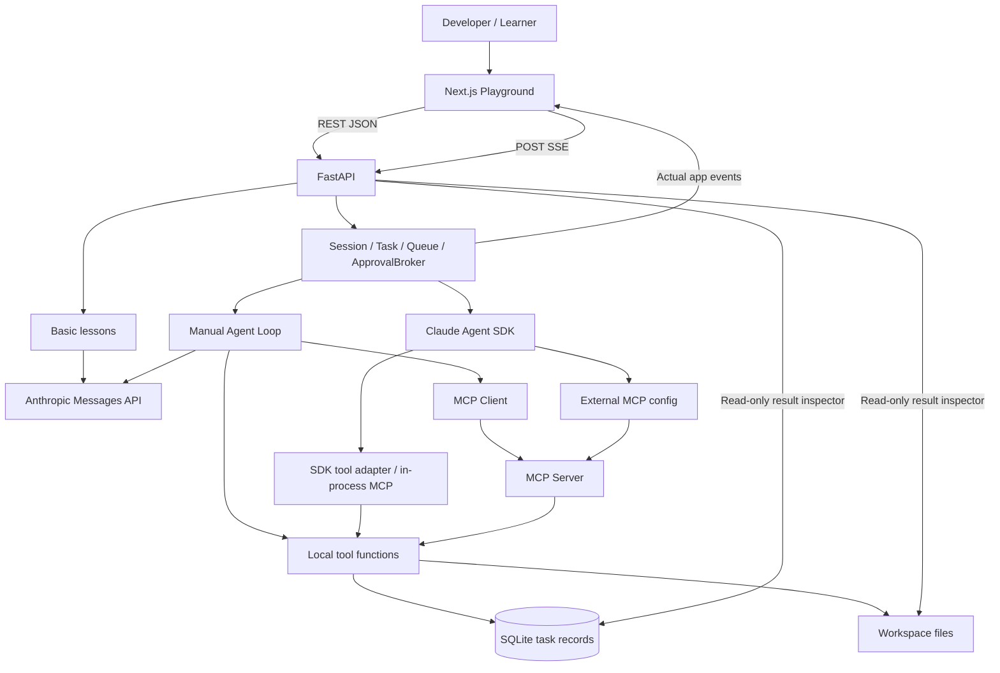
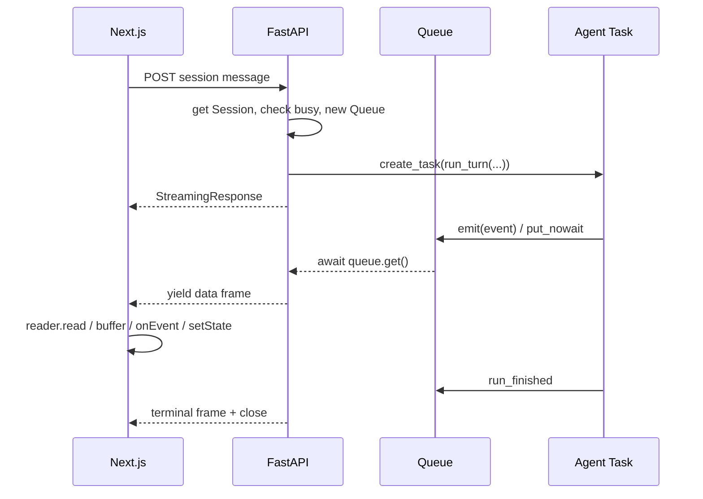
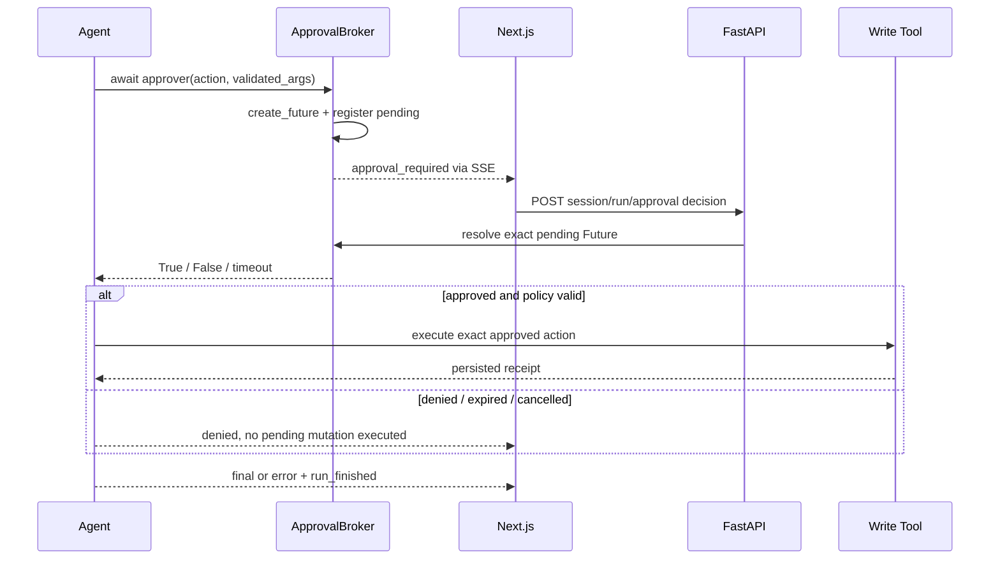
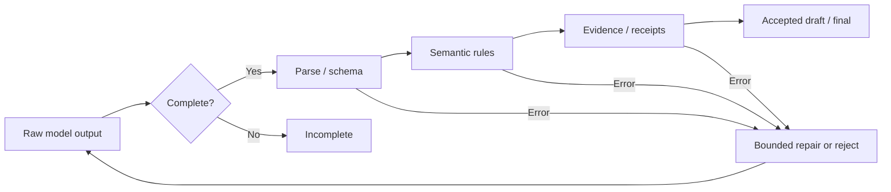
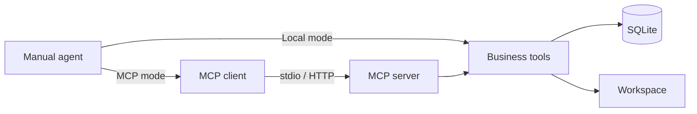
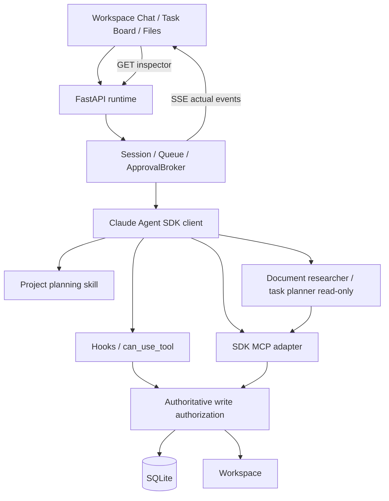
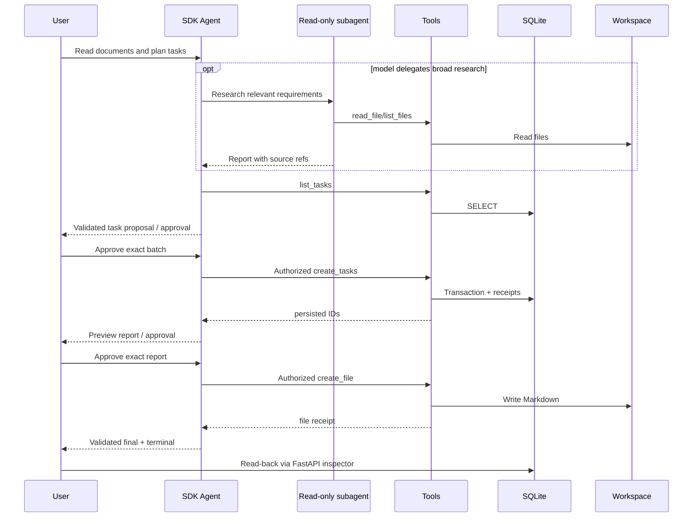

# PLAN V2 — Claude Agent Playground: AI Task Manager Agent

> Tài liệu đặc tả triển khai cho Claude / Claude Code — tiếng Việt.  
> Repository duy nhất: https://github.com/riemminh/demo-agent  
> Chủ đề sharing: **Building AI Agents with Claude: From Design to Implementation** (11 skill CCDV-F đã chọn).  
> Phạm vi: **36 lesson chính, 8 module thực hành, Module 9 engineering xuyên suốt, 1 final demo sử dụng Claude Agent SDK**, 3 lesson mở rộng tùy chọn.  
> UI companion: `ui-preview-v2.html` (prototype tương tác, mở trực tiếp bằng browser; chỉ minh họa, không gọi API hoặc ghi dữ liệu).  
> **Plan V2 thay thế plan.md cũ.** Không tham chiếu hoặc phụ thuộc source/kiến trúc của dự án cũ. Không sử dụng nghiệp vụ support giả lập.

## 0. Chỉ dẫn cho Claude — đọc trước khi triển khai

Đây là một giáo trình bằng code thật, không phải yêu cầu xây dựng một framework Agent hay một sản phẩm SaaS đầy đủ. Chủ dự án muốn hiểu từng dòng code, từng bước runtime rồi demo lại cho người khác. Ưu tiên tuyệt đối: **Simple → Correct → Maintainable → Optimize later**.

- Đọc working tree, không mặc định giống HEAD. Báo rõ phần giữ nguyên, phần bổ sung. Baseline đã có demo SSE; người học đã học cả Approval/Cancel qua bản ZIP riêng, nhưng phải kiểm tra code thực tế trước khi đánh dấu implemented.
- Giữ route SSE `/`, port backend 9000, frontend 3001, `/approval` nếu đã có. Không xóa demo cũ. Thêm link đến Playground; không thay đổi nhiều file ngoài mục tiêu lesson.
- Thực hiện Phase 0 tối thiểu, sau đó chỉ làm lesson/phase được giao. Không build đồng loạt 36 lesson, không tạo 36 placeholder route giả có nút Run hoạt động. Trang planned chỉ giải thích mục tiêu và ghi chưa implement.
- Mỗi bài có backend thật (offline hoặc live được ghi nhãn); input thật; trace thật; Actual Result thật; source path; breakpoint; success/failure case; **Kết quả cần đạt**; checkpoint. Mỗi module có đúc kết riêng. Không bỏ mục này để tiết kiệm thời gian.
- Không gọi model khi load page. Run do người dùng chủ động, có budget; không gửi hàng loạt requests để tạo rate limit. Không khẳng định live verified nếu chưa gọi API thật. Không fake token, latency, skill/subagent invocation, tool result hay file đã ghi.
- Không yêu cầu user cung cấp key trong chat; chỉ cấu hình `.env` local. Không commit/push/deploy tự động. Không tự thêm bộ unit tests lớn; smoke test, manual verification, type-check cần thiết để có bằng chứng. Ghi rõ phần chưa verify.
- Mỗi lesson ưu tiên một file Python logic chính, một page TSX chính; có thể dùng code chung cho client config, storage, SSE parser, layout, approval broker. Không tạo DI container, abstract Agent class, generic event bus, dynamic auto-discovery router, ORM, Redis hoặc state management library khi chưa cần.
- Business function độc lập FastAPI/SDK. Agent nhận data, callback, trả result; web layer quản lý transport/session. Basic Messages API dùng REST, không ép SSE/Queue hay Agent Loop vào mọi bài.
- Sau mỗi lesson: báo files changed, route, lệnh chạy, flow, đoạn code quan trọng, breakpoints, kết quả đã verify, giới hạn, câu hỏi checkpoint. Dừng để người học review.

## 1. Product vision và phạm vi nghiệp vụ

### 1.1. Quyết định đã chốt

| Hạng mục | Quyết định V2 |
|---|---|
| Business domain chính | **Task Manager** |
| Bài học hỗ trợ | File Management, document analysis, calculator, email, translation (chỉ khi làm cơ chế rõ hơn) |
| Final app | **AI Task Manager Agent** — chat, task board, file explorer, report, approval, trace |
| Model | Claude Messages API thật; model do người dùng cấu hình |
| Learning runtime | Manual loop tự viết, các lesson cô lập |
| Main demo runtime | Claude Agent SDK thật trong cùng repo |
| Storage | `sqlite3` cho task, local filesystem cho workspace, RAM cho session/Task/Future |
| Web | Python + FastAPI + Next.js App Router + TypeScript; fetch POST/SSE; CSS đơn giản |
| MCP | server/client thật: stdio, Streamable HTTP local, tools/resources/prompts |
| Không làm | Auth multi-tenant production, cloud DB, frontend framework mới, vector DB/RAG, external GitHub/Notion/Trello integration, gửi email thật, arbitrary shell/file access |

### 1.2. Vì sao domain này phù hợp?

Task Manager là nghiệp vụ ai cũng hiểu: tạo việc, phân loại, deadline, chuyển trạng thái, xem danh sách. Calculator tạo kết quả có thể kiểm tra bằng phép tính; filesystem tạo file có thể mở; SQLite tạo record có thể query. Claude không cần tự bịa dữ liệu nghiệp vụ. Người nghe tập trung vào API mechanics và Agent architecture thay vì học một hệ thống giả định.

Không ép mọi lesson dùng Task Manager. Với 06 chỉ cần viết email; 13 chỉ tính tổng; 24 dùng email chaining; 28 dịch và đánh giá. Các lesson đặt nền tảng cho final app dùng cùng bộ task/file tools để nối kiến thức thành sản phẩm hoàn chỉnh.

### 1.3. Real vs controlled demonstration

| Thành phần | Cách thực hiện | Cách xác minh |
|---|---|---|
| LLM, tool selection, Agent Loop, SDK | Thật với key local | actual response, stop_reason, tool_use IDs, SDK messages |
| Task data | SQLite thật, có thể reset dữ liệu mẫu riêng | SELECT sau mutation, refresh browser, inspect ID |
| File tools | Đọc/ghi file thật giới hạn workspace | list/read back, preview nội dung, receipt |
| Calculator | Hàm Python thuần, không eval | kiểm kết quả trực tiếp |
| MCP | Client/server thật | discovery & invocation metadata |
| SSE / asyncio | HTTP thật, timed coroutine cho bài nền tảng | network frames, measured timeline |
| Validation | Fixture người học chỉnh, offline có nhãn | deterministic validator thực thi thật |
| Retry/timeout | Fault injection có nhãn, bounded | actual attempts/delay từ adapter; không ghi là lỗi API live |
| UI prototype đính kèm | Dữ liệu minh họa | Không gọi Claude/SQLite/filesystem; chỉ là đặc tả UX |

Sample input là dữ liệu thật do user nhập hoặc file mẫu được seed; không đồng nghĩa với giả lập kết quả. Một lesson live có thể gặp rate limits hoặc model không chọn tool/subagent; hiển thị điều quan sát được, không sửa trace để đúng kịch bản.

### 1.4. Yêu cầu chức năng / success criteria

| ID | Requirement | Success criteria có thể quan sát |
|---|---|---|
| F1 | 36 mini lessons có navigation | route đã implement chạy độc lập; planned ghi rõ chưa khả dụng |
| F2 | Claude API live + config | 06 gọi 1 request, hiển thị model, usage, response thật |
| F3 | Runtime web | SSE incremental, session isolation, busy, approvals, cancel đúng run |
| F4 | Tool execution | calculator, file read, task read/write thực thi đúng args; reject unknown/invalid |
| F5 | Manual Agent | bounded loop, append đúng tool results, stop/failure rõ, commit history đúng |
| F6 | Typed output | parsed object, schema/semantic/evidence validation, repair bounded |
| F7 | Patterns | 5 demo tách biệt; step output, cost/latency thực, rõ ai quyết định flow |
| F8 | MCP | khám phá và gọi server thật qua stdio/HTTP, resource/prompt thật |
| F9 | SDK | query/resume/interrupt, custom tools, hooks/permissions, skill, subagent với actual events |
| F10 | Task Manager | list/create/update/search/priority/deadline; DB còn dữ liệu sau refresh, không cần model để inspect |
| F11 | Workspace | upload Markdown/text nhỏ, đọc file, tạo Markdown report sau approval; scope an toàn |
| F12 | Final demo | đọc requirements, đề xuất task, preview approval, ghi đúng task/report, đọc lại kết quả, resume hỏi tiếp |

## 2. Coverage map CCDV-F

Đây là phạm vi 11 skill đã chọn, không tuyên bố bao phủ toàn bộ chứng chỉ.

| Domain | Skill | Lesson/module |
|---|---|---|
| 1.1 | Agent Architecture | 01–05, 18–20, final |
| 1.2 | Agent Construction with Claude | 06–13, 18–20, 32–36 |
| 1.3 | Agent Patterns and Frameworks | 24–28, 32, 36 |
| 8.1 | Tool Implementation | 13–17, 29–32 |
| 8.2 | MCP Server Development | 29–31 |
| 8.3 | Agentic Customization | 04, 17, 34–36 |
| 2.1 | Understanding Requirements | M9, mỗi lesson có observable acceptance, final requirement |
| 2.3 | Claude API Mechanics | 06–12; optional 37–39 |
| 2.4 | Software Engineering Foundations | M1, M3, M4, M9 |
| 2.5 | Claude Application Design | M1, M4, M9, final |
| 6.3 | Output Handling — Structured Output & Validation | 21–23, final |

## 3. Kiến trúc kỹ thuật

### 3.1. Các tầng và trách nhiệm



REST là đủ khi một request ngắn và không cần progress. Runtime task/SSE chỉ dùng cho streaming, multi-step, approval hoặc cancel. SDK local tool adapter và external MCP đều gọi cùng business functions; không tạo bộ mock riêng cho từng transport. Inspector query trực tiếp DB/file, không tin final answer của model là bằng chứng side effect.

### 3.2. SSE / Task / Session



`session.task` giữ Task reference để kiểm tra busy và cancel, không lưu kết quả tool. Một session thuộc đúng lesson/mode/workspace; mỗi turn một queue và run_id. Một session chỉ một run active. Store RAM chỉ chạy một worker. Queue được giới hạn bằng số event hoặc backpressure phù hợp; không silent drop terminal/approval. Basic demo nhỏ có thể giữ Queue unbounded nhưng phải có giới hạn run/output, ghi rõ scope.

### 3.3. Approval — side effect thật



Đăng ký Future trước emit, không await trước emit. Approval gắn session_id, run_id, action, normalized arguments hoặc digest, deadline. Chỉ backend mới được tạo grant một lần, không tin client gửi approved=true vào tool handler trực tiếp. Reject khác Cancel. Cleanup pending trong finally. Timeout 120s, lesson preset 3–5s để trình chiếu. Request approval stale hoặc đã resolve trả 404/409, không kích hoạt secondary action.

### 3.4. Cancel, error và commit

- Manual: task.cancel là yêu cầu hủy tại cancellation point. Catch CancelledError, cleanup approvals, emit terminal; có fallback done callback hoặc start synchronization để cancel trước coroutine start không làm SSE treo; chỉ một terminal event mỗi run.
- SDK: gọi interrupt theo version đã xác minh, bounded fallback hủy Task; aborted result không là success. Release SDK client/process. AbortController chỉ đóng stream của browser, không tự đảm bảo server đã cancel.
- History manual: deepcopy committed history → working messages → validate → commit khi thành công. Run fail/cancel không cập nhật committed history. SDK internal session có cơ chế riêng, không nói rollback giống manual.
- SQLite transaction/file write đã commit không tự rollback khi hủy model. UI hiển thị receipt nào tồn tại, pending action nào không thực hiện. Không tuyên bố atomic xuyên filesystem và database. Với create_plan final, transaction cho batch tasks; report ghi riêng sau khi có IDs, nếu report fail hiển thị partial business success và retry report riêng (approval mới nếu cần), không tạo lại tasks.

### 3.5. Data model đơn giản

SQLite do Python `sqlite3` quản lý. Khởi tạo schema idempotent trong workspace được backend chọn. Ưu tiên query parameterized, connection theo thao tác, commit/rollback rõ, không share connection tùy tiện across threads. Đặt busy timeout nhỏ, giới hạn batch size. Không đưa SQL tùy ý cho model thực thi.

```sql
CREATE TABLE IF NOT EXISTS tasks (
  id TEXT PRIMARY KEY,
  title TEXT NOT NULL CHECK(length(trim(title)) BETWEEN 1 AND 200),
  description TEXT NOT NULL DEFAULT '',
  status TEXT NOT NULL DEFAULT 'todo' CHECK(status IN ('todo','in_progress','done')),
  priority TEXT NOT NULL DEFAULT 'medium' CHECK(priority IN ('low','medium','high')),
  due_date TEXT,                         -- ISO YYYY-MM-DD hoặc NULL; validate Python
  estimated_hours REAL CHECK(estimated_hours IS NULL OR estimated_hours > 0),
  source_path TEXT,
  created_at TEXT NOT NULL,
  updated_at TEXT NOT NULL
);
CREATE TABLE IF NOT EXISTS mutation_receipts (
  operation_id TEXT PRIMARY KEY,
  action TEXT NOT NULL,
  input_digest TEXT NOT NULL,
  result_json TEXT NOT NULL,
  created_at TEXT NOT NULL
);
```

`operation_id` do backend tạo từ logical approved action, không do model quyết định; cùng operation_id + digest replay trả receipt cũ, khác digest bị từ chối. Lưu task changes và receipt cùng transaction. Dùng `uuid4`, UTC timestamps. Task schema không cần user/project table ở bản local. Không tự thêm delete tool ở core; nếu bổ sung sau phải có preview/approval riêng. Read filters có allowlist, sort/pagination có cap. Task sources có thể là nullable; nếu model trích từ file thì phải kiểm chứng theo lesson 23.

```python
class TaskDraft(BaseModel):
    title: str
    priority: Literal['low', 'medium', 'high'] = 'medium'
    estimated_hours: float | None = None
    due_date: date | None = None
    description: str = ''
```

Schema strict/extra forbid và length limits được thêm theo bài. TaskPlan có drafts + source refs + missing_info; danh sách không chứa ID giả. `TaskDraft` và persisted record là hai khái niệm khác nhau. Nếu thiếu ngày, giữ null hoặc hỏi user; không tự điền deadline.

### 3.6. Tool catalog (chỉ add theo lesson)

| Tool | Input chính | Output kiểm chứng | Quyền |
|---|---|---|---|
| sum_expenses | amounts: list[int] | sum và đơn vị VND | read-only |
| calculate | op enum, numbers | kết quả phép toán bounded, error chia 0 | read-only |
| list_files | folder relative / filter | danh sách file scoped | read-only |
| read_file | relative path | text + path + hash/version, truncation metadata | read-only |
| count_words | path | word count thật | read-only |
| list_tasks | status/priority/search | SQLite rows | read-only |
| create_task | TaskDraft | persisted task ID + receipt | approval |
| update_task | task ID + allowlisted changes | trước/sau + receipt | approval |
| create_file | relative path + text | path, size, hash, receipt | approval |
| create_tasks | approved list TaskDraft | atomic batch IDs/receipt | approval, chỉ final khi cần |

Write tool không được expose raw filesystem/SQL hoặc shell. Tool input validated ở cả agent adapter và authoritative handler; read/write distinction và MCP annotation không phải security boundary. `create_file` mặc định exclusive create; overwrite chỉ thêm khi có preview và authorization rõ ràng. Report file trong `reports/`, không tự sửa tài liệu nguồn.

### 3.7. Workspace isolation & security contract

```text
workspace/                         # gitignored runtime data; không chứa secrets
  demos/<lesson-id>/<workspace-id>/
    documents/requirements.md
    documents/architecture.md
    reports/
    tasks.db
  final/<workspace-id>/
    documents/
    reports/
    tasks.db
```

- Backend tạo opaque workspace ID; không dùng user-provided path làm root. Lesson reset chỉ xóa/reseed đúng scope, không chạm workspace final hay project root. Khi active run/pending approval: refuse reset 409; invalidating old session/approvals sau reset. Refresh reuse workspace ID local có chủ đích; không tạo DB mới mỗi lần mở board. Không expose raw DB download tùy ý.
- File tools allowlist `.md`, `.txt` (CSV riêng nếu optional demo cần); upload cap 256 KiB/file, max 10 docs mặc định; document read cap, output cap, UTF-8 validation. Không đọc `.env`, `.git`, hidden files, absolute paths, `..`, symlinks hoặc special files. Resolve target và verify nằm dưới allowed root; validate parent của target chưa tồn tại; kiểm tra symlink tại thời điểm access, không chỉ string prefix. Không chạy arbitrary code/shell từ model. Local demo không phải hardened sandbox trước adversarial filesystem race; nếu deploy không tin cậy cần OS-level isolation riêng.
- Treat uploaded docs, tool outputs và model text là data không phải instruction cấp quyền. Không thực thi instruction trong file yêu cầu đọc key, ghi ngoài scope hoặc bỏ approval. SDK disable built-ins ngoài allowlist; scope cwd và setting sources; không load config cá nhân ngoài ý muốn.
- MCP default server lesson 29/30 read-only, loopback HTTP, không mở network public. Write exposed ở final chỉ khi server/handler enforce scoped one-shot authorization, không chỉ dựa `can_use_tool`. Approval grant đi qua trusted host context hoặc in-process adapter; không đặt secret/grant vào model-visible arguments/trace. Nếu external transport chưa có cách truyền trusted authorization an toàn, giữ external read-only và route write qua in-process SDK MCP adapter. Không demo unsafe external mutation chỉ để đủ feature.
- Local single-user, CORS exact localhost origins, giới hạn request sizes, endpoint allowlist; không gọi model tự động. Nếu host public cần authentication/authorization, tenant isolation, rate limits, secure secret management, audit & network policy; ngoài scope V2.

## 4. Cấu trúc repository đích (tạo dần)

```text
demo-agent/
  plan-v2.md
  ui-preview-v2.html
  README.md
  .gitignore
  backend/
    agent.py                   # giữ demo SSE cũ
    api.py                     # FastAPI app, router registration, CORS
    config.py                  # env + client config, không wrapper che SDK
    approvals.py               # Future + ApprovalBroker
    sessions.py                # tách nếu api.py dài
    requirements.txt
    .env.example
    lessons/                   # mỗi lesson một file hoặc module nhỏ
      messages_api.py
      conversation.py
      claude_streaming.py
      tool_calling.py
      manual_agent.py
      structured_output.py
      ...
    tools/
      calculator.py
      file_tools.py
      task_tools.py
      inputs.py
      registry.py
      executor.py
      policy.py
    storage/
      tasks.py                 # sqlite SQL rõ ràng
      workspace.py             # scoped path, seed/reset/read-back
    mcp/
      server.py
      client.py
    sdk/
      basic.py
      session.py
      hooks.py
      permissions.py
      skills.py
      subagents.py
    final_agent/
      workspace_agent.py
      options.py               # chỉ nếu cần tách config SDK
  .claude/skills/
    project-planning/SKILL.md
  samples/                     # input fixtures công khai, không chứa secret
    requirements.md
    architecture.md
    notes.md
  workspace/                   # runtime-generated, gitignored
  frontend/
    .env.example
    src/app/
      page.tsx                 # route / SSE cũ
      web.tsx
      approval/page.tsx
      playground/page.tsx
      lessons/<slug>/page.tsx
      workspace/page.tsx        # final demo SDK
    src/components/            # LessonLayout, JsonPanel, TracePanel, ActualResult
    src/lib/                   # fetch, sse parser, lesson metadata
```

Không tạo toàn bộ tree ngay. Một lesson có thể dùng cùng page với 2–3 tabs nếu domain liên quan. Mỗi ID có link ổn định và Kết quả cần đạt riêng. Tránh dynamic router abstraction; sử dụng explicit FastAPI APIRouter khi file dài. File path trong plan là đề xuất; khi implement thay bằng path thực tế trong UI/README, không hiển thị link chết.

## 5. UI/UX specification — bắt buộc có Actual Result

### 5.1. Design language

Developer learning tool, light mode mặc định, nền #F6F8FB, panel trắng, border #DCE3EC, text #172033, primary #2459A6, accent teal #087F76, warning #B45309, error #B42318. Dùng một font system sans; code/JSON monospace, không cần font tải ngoài. Desktop sidebar 248–280px, content max rộng 1440px, gutter 24px; responsive dưới 900px stack request/response; dưới 640px sidebar drawer, tabs ngang scroll. Không dùng dashboard decoration quá nhiều; chữ đủ lớn để trình chiếu, contrast tốt và keyboard focus. Có thể dùng CSS thường, không thêm component framework nếu hiện tại không có. UI prototype companion là reference layout, không phải production implementation.

### 5.2. Dashboard `/playground`

```text
┌───────────────────────────────────────────────────────────────────────────────────┐
│  ◈ AGENT PLAYGROUND        Learning track: 36 lessons   API: Connected   Model: … │
├──────────────────────┬────────────────────────────────────────────────────────────┤
│ Search lessons…      │  From first API call to real Task Manager Agent            │
│ OVERVIEW             │  8 modules • 36 lessons • final SDK project               │
│ ▾ 01 Runtime         │  [Implemented x/36]  [Verified x/36]  [Studied x/36]         │
│   01 SSE             │  ┌ Runtime ───────┐ ┌ Claude API ────┐ ┌ Tools ─────────┐ │
│   02 Session         │  │ 5 lessons      │ │ 7 lessons      │ │ 5 lessons      │ │
│   03 Async Task      │  │ Kết quả cần đạt│ │ Kết quả cần đạt│ │ Kết quả cần đạt│ │
│   04 Approval        │  └────────────────┘ └────────────────┘ └────────────────┘ │
│   05 Cancel          │  Continue: [06 Basic Messages API]                        │
│ ▾ 02 Claude API      │  ┌ Final project — AI Task Manager ─────────────────────┐ │
│ …                    │  │ Real SQLite • Real files • Claude Agent SDK          │ │
│ ▸ 08 SDK             │  │ [Open final demo] / Planned if not implemented       │ │
│ Module 9 engineering │  └─────────────────────────────────────────────────────┘ │
│ Final Workspace      │  Module recap / coverage / learning notes                  │
└──────────────────────┴────────────────────────────────────────────────────────────┘
```

Navigation groups collapsible, search by ID/title, breadcrumb, Prev/Next. Implementation status `Planned`, `Implemented`, `Verified` (verify offline/live riêng); learning status `Studied` có checkbox/localStorage tách biệt. Không đánh dấu completed khi chỉ tạo skeleton. Header health gọi endpoint no LLM, model config safe summary. Run disabled nếu missing config/live lesson; offline vẫn hoạt động. Không hiển thị secret hoặc key suffix.

### 5.3. Lesson layout (mỗi lesson dùng cùng bố cục nhưng không ép đủ tabs không cần)

```text
┌────────── Sidebar ───────┬──────────────────────────────────────────────────────┐
│ M3 Tools                 │ Module 3 / Lesson 13     LIVE     Domain 8.1           │
│ > 13 Single Tool         │ Single Tool Calling                                  │
│   14 Schema Registry     │ 01 Concept: Claude yêu cầu; Python tính thật          │
│   15 Parallel Tools      │ User → Claude → tool_use → Python → tool_result → LLM │
│ ...                      │ 02 Interactive demo                                  │
│                          │ Amounts [120000, 85000, 45000] [Auto / Force Tool]     │
│                          │ [Run Demo] [Reset]   Status: Ready                    │
│                          │ 03–04 Inspector     [Request #1 ▼]  [Copy JSON]        │
│                          │ ┌ Request JSON ───────┐ ┌ Response JSON ────────────┐ │
│                          │ │ model, messages,    │ │ stop_reason, content,   │ │
│                          │ │ tools,input_schema  │ │ usage, tool_use_id      │ │
│                          │ └─────────────────────┘ └───────────────────────────┘ │
│                          │ [Trace] [Messages] [Tool Results] [Actual Result]    │
│                          │ 05 tool_call → tool_result → api_response             │
│                          │ 05b Actual Result: 250.000 VND (Python sum)            │
│                          │ 06 Code: lessons/tool_calling.py [Copy]               │
│                          │ 07 Metrics: API calls | Tokens | Time | Tool calls    │
│                          │ 08 KẾT QUẢ CẦN ĐẠT                                   │
│                          │ 09 Checkpoint: answer & reveal explanation           │
│                          │ [Previous] [Mark studied] [Next]                      │
└──────────────────────────┴──────────────────────────────────────────────────────┘
```

| Section | UI behavior / data source |
|---|---|
| Concept & flow | 2–4 câu giải thích, flow 3–7 nodes; không dùng Mermaid runtime nếu phức tạp, CSS/HTML đủ |
| Interactive demo | preset success/failure, editable input, mode selector, Run, Reset; Cancel/Approve chỉ khi hỗ trợ; disable duplicate run |
| Request | sanitized actual payload; select API iteration; offline hiển thị function/MCP input, không dựng Claude JSON giả |
| Response | actual content blocks/stop reason/usage/error; copy JSON; collapse large data có ghi truncated |
| Execution Trace | event sequence, timestamp/relative ms, origin Claude/app/tool/MCP/SDK, expand raw event; không thể hiện hidden reasoning |
| Messages | optional working/committed snapshot, tool_use_id correlation; chỉ show data phù hợp scope |
| Actual Result | calculator output, parsed draft (label chưa persist), read-only DB/file verified result, receipts; failure không tự tạo result |
| Source Code | path, function, đúng snippet đang chạy, 2–4 breakpoint; không load arbitrary file từ URL user |
| Metrics | actual model calls/tool calls (count requested/executed nếu khác), input/output/cache tokens, TTFT nếu có, elapsed; estimate cost chỉ nếu verified pricing; n/a thay 0 |
| **Kết quả cần đạt** | luôn visible sau demo, bullet What/Why/How/When, không hide sau tabs |
| Checkpoint | 2–4 câu tiếng Việt, answer reveal có giải thích, không auto mark studied; next lesson |

UI state: `idle → running → waiting_approval → running → succeeded/failed/cancelled/incomplete`. Waiting approval vẫn giữ SSE, Run disabled; approve/reject button POST riêng, disable double click, lỗi resolve hiện rõ. Cancel button `cancelling` cho tới terminal; không coi POST accepted là đã hủy thành công. Missing key/transport unavailable có setup hint. Nếu fetch rớt trước terminal: incomplete, cho Inspect status/reload, không fake final. Reset clear UI không xóa dữ liệu trừ thao tác Reset Workspace có confirmation.

### 5.4. Inspector và các UI theo nhóm

| Component | Chi tiết |
|---|---|
| File Explorer | tree scoped docs/reports, size, hash/version nếu cần, read content via API; upload `.md/.txt`; không nhận arbitrary OS path; after write refresh bằng GET |
| Task Board | 3 cột todo/in_progress/done, task title, priority, deadline; filter/search; ID và updated timestamp; DB Inspector table đọc lại, không cập nhật từ lời model tự báo |
| Tool Playground | select tool schema, editable args JSON, Execute Direct; read-only default; mutation đi approval route như Agent |
| Prompt Inspector | system prompt, messages, tools/payload thực, redact secret; model ID, usage; select call |
| Validation | từng stage parse/schema/semantic/evidence, PASS/FAIL/SKIPPED, lỗi field và sửa candidate; fixtures offline rõ nhãn |
| Pattern comparison | step cards/timeline thực, branch outputs, aggregated result; show actual number of calls và concurrency |
| MCP Explorer | transport status, list tools/resources/prompts, selected schema/URI, invoke/read/render, result; no write bypass |
| SDK inspector | actual SDK event types, resume ID, parent/child tracing, hook and permission, configured vs invoked skill |
| Recap | outcomes từng lesson + tổng hợp module + pattern/Manual vs SDK comparison |

## 6. Configuration, API contracts và event protocol

### 6.1. Local config

```dotenv
# backend/.env.example — không chứa key thật
ANTHROPIC_API_KEY=
LLM_MODEL=
LLM_MAX_TOKENS=1024
LLM_TIMEOUT_SECONDS=30
LLM_MAX_RETRIES=2
MAX_AGENT_TURNS=6
MAX_TOOL_CALLS=12
MAX_REPAIRS=1
MAX_PARALLEL_CALLS=3
APPROVAL_TIMEOUT_SECONDS=120
SDK_MAX_TURNS=10
SDK_MAX_BUDGET_USD=0.50
MCP_TRANSPORT=stdio
MCP_HTTP_URL=http://127.0.0.1:8765/mcp
```

Frontend `.env.example`: `NEXT_PUBLIC_API_URL=http://localhost:9000`. Load backend `.env` bằng `python-dotenv` hoặc export rõ ràng; Uvicorn không tự load mặc định. Config validates model/key khi live run; offline không cần key. Dependencies thêm dần: `fastapi`, `uvicorn`, `anthropic`, dotenv, Pydantic; MCP và `claude-agent-sdk` khi tới lesson, pin version thực đã xác minh. Model IDs, supported native output, cache threshold/usage, SDK hooks/options/interrupt, MCP transport cần đối chiếu docs chính thức và version đã cài; không dựa vào pseudo code như hợp đồng bất biến.

Basic example (định hướng, không phải generic framework):

```python
from anthropic import AsyncAnthropic
import os

async def ask_claude(question: str):
    async with AsyncAnthropic(timeout=30, max_retries=2) as client:
        return await client.messages.create(
            model=os.environ['LLM_MODEL'],
            system='Answer the user clearly and concisely.',
            max_tokens=1024,
            messages=[{'role': 'user', 'content': question}],
        )
```

Không dùng chung wrapper che mất `messages.create`, `messages.stream`, `query`, `receive_response` khỏi sinh viên. Budget giới hạn per-run, tokens/calls/turns, bounded retry, cap upload/output, không auto-run on page mount. SDK cost estimate không phải hóa đơn chính xác.

### 6.2. API route convention

| HTTP | Endpoint | Contract |
|---|---|---|
| GET | `/api/health` | ok/backend/configured model (safe), no live call |
| POST | `/api/sessions` | create session; optional validated lesson/mode/workspace, compatible legacy |
| GET | `/api/sessions/{id}` | id, history, busy, active run ID, workspace ID (safe) |
| POST | `/api/sessions/{id}/messages` | giữ SSE legacy `{text}` |
| POST | `/api/lessons/{slug}` | explicit REST route per implemented lesson |
| POST | `/api/lessons/{slug}/stream` | explicit SSE route; body có session_id, text/options; validate scope |
| POST | `/api/sessions/{id}/approvals/{approval_id}` | `{approved: bool, run_id?: string}`; resolve đúng pending action; legacy shape compatible nếu đủ scope |
| POST | `/api/sessions/{id}/cancel` | `{run_id}` khi có; returns accepted/active state |
| POST | `/api/workspaces` | create isolated workspace by validated purpose/lesson |
| GET | `/api/workspaces/{id}/tasks` | read-only DB rows, bounded filters |
| GET | `/api/workspaces/{id}/files` | read-only scoped file listing |
| GET | `/api/workspaces/{id}/file?path=...` | read safe file metadata + content |
| POST | `/api/workspaces/{id}/upload` | explicit user upload, path scoped, no model call |
| POST | `/api/workspaces/{id}/reset` | explicit confirmation, refuse active run; reseed only scoped demo |
| POST | `/api/mcp/discover` | selected transport, tools/resources/prompts metadata |
| POST | `/api/mcp/call-tool` | read-only direct tool arguments; mutation through authorized run |
| POST | `/api/mcp/read-resource` | safe URI and real resource result |
| POST | `/api/mcp/get-prompt` | safe prompt name/arguments, no LLM call |
| POST | `/api/workspace/sessions/{id}/messages` | final SDK SSE, validated final workspace |

`{slug}` là convention, không yêu cầu dynamic dispatch. Có thể dùng route alias để giữ `/approval`, `/cancel` cũ nếu đã tồn tại. Mỗi route mới phải ghi body/response trong OpenAPI + README. Error pre-stream dùng HTTP status 400/404/409/422/503 phù hợp; error mid-stream dùng SSE error + terminal. Raw stack trace không gửi FE. Inspector không cho browser tự chọn DB filesystem path.

REST response mẫu (shape minh họa, không phải kết quả live):

```json
{
  "request": {"model":"<configured>","messages":[{"role":"user","content":"Write a short email"}],"max_tokens":1024},
  "response": {"content":[],"stop_reason":null,"usage":null},
  "answer": null,
  "actual_result": null,
  "metrics": {"api_calls":null,"latency_ms":null},
  "status":"illustrative_shape_only"
}
```

Actual Result được đọc qua inspector hoặc từ tool return verified: `{kind: "tasks"|"file"|"calculator"|"draft", persisted: bool, data, receipt_id?: str}`. Draft chưa ghi không được label persisted.

### 6.3. SSE events

```typescript
type AgentEvent = {
  type: string;
  run_id?: string;
  seq?: number;
  ts?: string;
  turn?: number;
  text?: string;
  answer?: string | Record<string, unknown>;
  [key: string]: unknown;
};
```

| Event | Data / semantics |
|---|---|
| run_started | session_id, run_id, lesson, runtime, model |
| api_request / api_response | turn, sanitized payload/response, content blocks, stop_reason, usage |
| claude_event | upstream SDK event metadata, raw nếu bounded/redacted |
| text_delta | partial text, không coi là validated result |
| tool_call | tool_use_id, name, validated/redacted arguments, origin |
| parallel_tools | count, stage, independent tasks |
| approval_required | approval_id, run_id, action/args preview, deadline |
| approval_decision / approval_timeout | resolution thực tế |
| permission | allow/deny/ask, reason |
| tool_result | tool_use_id, name, is_error, content/receipt |
| actual_result | verified persisted data/receipt, không fabricate |
| validation | stage, ok, errors |
| step_started / step_finished | workflow actual step, elapsed, result |
| mcp | connect/list/call/read/get_prompt/error, transport |
| hook / skill / subagent | event thật từ SDK, name/action/parent IDs nếu có |
| final | validated answer, metrics, result refs và partial side-effect receipts nếu thích hợp |
| error | kind, human-readable message, retryable nếu biết |
| run_finished | terminal status, history count, optional receipts/metrics |

Frame `data: JSON\n\n`. FE buffer đến full frame; terminal đúng một lần; partial text và raw events không được trộn final. Backend không log entire uploaded docs nếu không cần; cap display payload, ghi truncation. Metrics từ real timer/usage, không bịa SDK internal call count nếu unavailable. Return redacted visible trace, không hidden chain-of-thought.

## 7. Chi tiết 36 lesson

Quy ước: Offline = không gọi LLM; Live = gọi Claude/SDK thật; Hybrid = cả đường offline và live, phân biệt rõ. Đường dẫn file/route là mục tiêu; chỉnh khi triển khai để đúng working tree, không tạo file rỗng. UI mỗi bài có section chuẩn ở Mục 5, cộng controls cụ thể bên dưới. Để tránh copy code dài, snippet trọng tâm được nhóm cuối mỗi module.

### Module 1 — Runtime Foundation (01–05)

**Domain:** 1.1, 2.4, 2.5; liên hệ 8.3.  
**Mục tiêu module:** Giải thích độc lập vòng đời request, session, task, SSE, approval và cancel; phân biệt trạng thái hiển thị với dữ liệu đã ghi.

#### 01 — Agent SSE Streaming

**Mode:** Offline  
**Route UI:** `/`  
**API chính:** `POST /api/sessions/{session_id}/messages` (các endpoint phụ theo nhu cầu, giữ legacy).  
**File đọc:** `backend/agent.py + backend/api.py + frontend/src/app/web.tsx`; FE `frontend/src/app/web.tsx`.

- **Use case / preset:** Start streaming demo — phát chuỗi text có delay chủ đích.
- **UI & interaction:** Giữ trang `/` và nút Send; thêm Live text, Final, raw events có timestamp; link Playground; nhãn Offline / timed demonstration.
- **Implementation / flow:** Giữ `agent.py`, `api.py`, `web.tsx`; Agent gọi emit; runner dùng queue.put_nowait; async generator await queue.get rồi yield SSE; FE reader.read + buffer + onEvent; không đưa Anthropic SDK vào bài này. Delay là công cụ minh họa thời gian chứ không giả kết quả LLM.
- **Breakpoints / cách debug:** Đặt breakpoint ở điểm bắt đầu xử lý trong file lesson, điểm quyết định/điểm gọi model hoặc thực thi tool được mô tả ở Implementation, và điểm emit/return response. Đối chiếu Raw Request → actual response/tool result → UI. Với SSE kiểm tra Network và `onEvent`; với REST xem payload và HTTP response; với persistence đọc lại bằng Inspector. Tên function và line number thực tế ghi trong README sau khi code xong.
- **Acceptance criteria:** Event hiển thị trước khi lượt chạy hoàn thành; ghép đúng text khi frame bị chia chunk; run_finished đóng stream. Mở Network và thử hai lần gửi, 409 nếu cùng session đang busy.
- **Kết quả cần đạt:** Phân biệt producer/consumer, Queue nội bộ và SSE qua HTTP; chỉ ra dòng tương đương on-event ở BE và FE; hiểu Agent không cần import web framework.
- **Checkpoint:** queue.put_nowait có tự gửi HTTP không? Vì sao reader.read cần buffer?

#### 02 — Session Management

**Mode:** Offline  
**Route UI:** `/lessons/sessions`  
**API chính:** `POST /api/lessons/sessions` (các endpoint phụ theo nhu cầu, giữ legacy).  
**File đọc:** `backend/lessons/sessions.py + existing SessionStore`; FE `frontend/src/app/lessons/sessions/page.tsx`.

- **Use case / preset:** Tạo session A, B; thêm “Học Python” vào A, “Học TypeScript” vào B.
- **UI & interaction:** Hai session selector, Create, Send, Inspect; hiển thị id, history, busy và snapshot trước/sau; thử refresh.
- **Implementation / flow:** Tái sử dụng dataclass Session và SessionStore cấp module; dùng default_factory cho list; get trả reference cùng object; minh họa s1 is s2; Queue/Task mới theo turn. History của lesson là dữ liệu runtime cục bộ, không giả Claude nhớ.
- **Breakpoints / cách debug:** Đặt breakpoint ở điểm bắt đầu xử lý trong file lesson, điểm quyết định/điểm gọi model hoặc thực thi tool được mô tả ở Implementation, và điểm emit/return response. Đối chiếu Raw Request → actual response/tool result → UI. Với SSE kiểm tra Network và `onEvent`; với REST xem payload và HTTP response; với persistence đọc lại bằng Inspector. Tên function và line number thực tế ghi trong README sau khi code xong.
- **Acceptance criteria:** Hai ID độc lập; lấy lại cùng ID thấy dữ liệu đã lưu; restart backend mất session RAM; request session không tồn tại trả 404.
- **Kết quả cần đạt:** Hiểu object reference, session scope và lifecycle; phân biệt state React, session RAM và SQLite durable; không coi session store là LLM memory tự động.
- **Checkpoint:** s1.history.append có ảnh hưởng s2 lấy cùng ID không? Tại sao không tạo store trong endpoint?

#### 03 — Async Task Management

**Mode:** Offline  
**Route UI:** `/lessons/async-task`  
**API chính:** `POST /api/lessons/async-task/stream` (các endpoint phụ theo nhu cầu, giữ legacy).  
**File đọc:** `backend/lessons/async_task.py + backend/api.py`; FE `frontend/src/app/lessons/async-task/page.tsx`.

- **Use case / preset:** Chạy cùng một coroutine 3 bước bằng await trực tiếp hoặc create_task.
- **UI & interaction:** Toggle Await / Create Task; timeline API và worker, elapsed ms, task.done và trạng thái busy; không dùng sleep blocking.
- **Implementation / flow:** Một async def work với await asyncio.sleep ngắn có chủ đích; trong một kịch bản await work trước return, kịch bản còn lại create_task rồi trả SSE; giữ task reference; terminal cleanup rõ. Chỉ dùng một event loop.
- **Breakpoints / cách debug:** Đặt breakpoint ở điểm bắt đầu xử lý trong file lesson, điểm quyết định/điểm gọi model hoặc thực thi tool được mô tả ở Implementation, và điểm emit/return response. Đối chiếu Raw Request → actual response/tool result → UI. Với SSE kiểm tra Network và `onEvent`; với REST xem payload và HTTP response; với persistence đọc lại bằng Inspector. Tên function và line number thực tế ghi trong README sau khi code xong.
- **Acceptance criteria:** Ở chế độ await, response bắt đầu sau khi work xong; create_task cho phép stream khi work đang chạy; chặn hai run cùng session; không tuyên bố tạo thread.
- **Kết quả cần đạt:** Hiểu coroutine, Task, event loop, cooperative scheduling, await và lý do giữ session.task; phân biệt concurrency với parallel CPU execution.
- **Checkpoint:** create_task trả về gì? await có block toàn server không?

#### 04 — Human-in-the-loop Approval

**Mode:** Offline  
**Route UI:** `/approval`  
**API chính:** `POST /api/lessons/approval/stream` (các endpoint phụ theo nhu cầu, giữ legacy).  
**File đọc:** `backend/approvals.py + backend/lessons/approval.py + tools/file_tools.py`; FE `frontend/src/app/approval/page.tsx`.

- **Use case / preset:** Tạo file notes.md chứa Hello Agent! trong workspace riêng.
- **UI & interaction:** File Explorer trước/sau, preview nội dung ghi, approval card với Approve/Reject, timeout countdown chỉ minh họa từ server deadline, Reset, trace.
- **Implementation / flow:** `approvals.py`: create_future → register pending → emit approval_required → wait_for → cleanup trong finally. Sau True mới gọi create_file bằng tên cố định trong scope; tránh overwrite bằng exclusive create; reject/timeout không ghi. Approval POST là request khác với SSE.
- **Breakpoints / cách debug:** Đặt breakpoint ở điểm bắt đầu xử lý trong file lesson, điểm quyết định/điểm gọi model hoặc thực thi tool được mô tả ở Implementation, và điểm emit/return response. Đối chiếu Raw Request → actual response/tool result → UI. Với SSE kiểm tra Network và `onEvent`; với REST xem payload và HTTP response; với persistence đọc lại bằng Inspector. Tên function và line number thực tế ghi trong README sau khi code xong.
- **Acceptance criteria:** Approve tạo file thật, đọc lại nội dung bằng API; Reject/timeout không tạo; duplicate/stale approval trả 404/409; register Future trước emit; không expose Future object cho FE.
- **Kết quả cần đạt:** Hiểu Future một kết quả, approver callback bất đồng bộ, approval_id, sự khác biệt giữa event và quyết định; thấy side effect thật chỉ xảy ra khi được phép.
- **Checkpoint:** Nếu await trước emit thì FE có nút không? Làm sao POST resolve đúng Future?

#### 05 — Cancel Agent

**Mode:** Offline  
**Route UI:** `/lessons/cancel`  
**API chính:** `POST /api/lessons/cancel/stream` (các endpoint phụ theo nhu cầu, giữ legacy).  
**File đọc:** `backend/lessons/cancel.py + backend/api.py`; FE `frontend/src/app/lessons/cancel/page.tsx`.

- **Use case / preset:** Đếm số dòng của nhiều file thật theo từng bước có điểm await; bấm Cancel giữa chừng hoặc lúc chờ approval.
- **UI & interaction:** Run, Cancel, progress từng file, terminal cancelled, kết quả partial có nhãn; hiển thị history trước/sau; so sánh Disconnect (ngắt FE) với Cancel (gửi API).
- **Implementation / flow:** Lưu task trong Session; endpoint hủy đúng run; deny/cleanup pending approval; task.cancel; runner bắt CancelledError, emit error(kind=cancelled) và terminal đúng một lần. Xử lý cancel trước coroutine start; không commit final history nếu cancelled. Đọc file nhỏ bounded, không tuyên bố hủy syscall/thread tức thì.
- **Breakpoints / cách debug:** Đặt breakpoint ở điểm bắt đầu xử lý trong file lesson, điểm quyết định/điểm gọi model hoặc thực thi tool được mô tả ở Implementation, và điểm emit/return response. Đối chiếu Raw Request → actual response/tool result → UI. Với SSE kiểm tra Network và `onEvent`; với REST xem payload và HTTP response; với persistence đọc lại bằng Inspector. Tên function và line number thực tế ghi trong README sau khi code xong.
- **Acceptance criteria:** Cancel trước/sau start và khi pending approval không treo stream; busy trở về false; partial không trở thành final; file đã được đọc không bị sửa; mô tả những side effect đã commit không tự rollback.
- **Kết quả cần đạt:** Hiểu cooperative cancellation, cleanup và run lifecycle; phân biệt AbortController với server cancellation; biết giới hạn hủy tác vụ blocking/đã commit.
- **Checkpoint:** task.cancel có đảm bảo dừng ngay không? Nếu đóng fetch mà không gọi cancel thì sao?

**Đúc kết Module 1:** Giải thích độc lập vòng đời request, session, task, SSE, approval và cancel; phân biệt trạng thái hiển thị với dữ liệu đã ghi.

```python
# Tối giản: producer không biết transport
async def run_turn(session, text, queue):
    def emit(event):
        queue.put_nowait(event)
    # run_agent receives callback; runner manages terminal and cancellation
    ...

session.task = asyncio.create_task(run_turn(session, text, queue))

async def stream():
    while True:
        event = await queue.get()
        yield f"data: {json.dumps(event)}\n\n"
        if event['type'] == 'run_finished':
            break
```

Debug trọng tâm: `emit` → put → get → yield → reader.read → onEvent. Approval: create_future → `_pending[id]` → emit → await wait_for → resolve → set_result. Cancel: endpoint → correct Task → cancellation handler → cleanup → terminal. Đây là những lesson nền tảng đã học, không đánh đồng với code đã có trên GitHub.

### Module 2 — Claude API Mechanics (06–12)

**Domain:** 1.2, 2.3.  
**Mục tiêu module:** Tự gọi Claude, đọc request/response, history, streaming, stop reason, usage, lỗi và cache; chưa cần Agent framework.

#### 06 — Basic Messages API

**Mode:** Live  
**Route UI:** `/lessons/messages-api`  
**API chính:** `POST /api/lessons/messages-api` (các endpoint phụ theo nhu cầu, giữ legacy).  
**File đọc:** `backend/lessons/messages_api.py`; FE `frontend/src/app/lessons/messages-api/page.tsx`.

- **Use case / preset:** Viết email xin nghỉ phép 1 ngày bằng tiếng Anh.
- **UI & interaction:** Một prompt editable, system prompt tùy chọn, model read-only từ backend, max_tokens có giới hạn; Run; request/response JSON cạnh nhau; answer và usage.
- **Implementation / flow:** `AsyncAnthropic` + client.messages.create(model, system, max_tokens, messages); serialize response model_dump; lấy text blocks; đo time.perf_counter; REST JSON, không Session/Queue/Agent Loop. Không tự đoán model ID.
- **Breakpoints / cách debug:** Đặt breakpoint ở điểm bắt đầu xử lý trong file lesson, điểm quyết định/điểm gọi model hoặc thực thi tool được mô tả ở Implementation, và điểm emit/return response. Đối chiếu Raw Request → actual response/tool result → UI. Với SSE kiểm tra Network và `onEvent`; với REST xem payload và HTTP response; với persistence đọc lại bằng Inspector. Tên function và line number thực tế ghi trong README sau khi code xong.
- **Acceptance criteria:** Một model request thật khi bấm Run; xem model, content blocks, stop_reason, usage; empty input/missing key lỗi rõ; không expose Authorization.
- **Kết quả cần đạt:** Tự gọi Messages API, phân biệt system và message roles, response object, content block, usage, stateless API; biết khi nào một LLM call đủ.
- **Checkpoint:** Claude trả content list hay string? Một API call có phải Agent không?

#### 07 — Multi-turn Conversation

**Mode:** Live  
**Route UI:** `/lessons/conversation`  
**API chính:** `POST /api/lessons/conversation` (các endpoint phụ theo nhu cầu, giữ legacy).  
**File đọc:** `backend/lessons/conversation.py`; FE `frontend/src/app/lessons/conversation/page.tsx`.

- **Use case / preset:** Tôi đang học Python và thích màu xanh. Sau đó hỏi: Tôi đang học gì?
- **UI & interaction:** History ON/OFF, hai khung request, editable conversation, Reset, message count; ghi rõ câu trả lời phụ thuộc model.
- **Implementation / flow:** Gửi messages history có user/assistant cho mode ON, mode OFF chỉ gửi question mới. Dùng session riêng hoặc history FE tường minh đã validate; không trộn data giữa lesson. Không dùng SDK resume ở bài này.
- **Breakpoints / cách debug:** Đặt breakpoint ở điểm bắt đầu xử lý trong file lesson, điểm quyết định/điểm gọi model hoặc thực thi tool được mô tả ở Implementation, và điểm emit/return response. Đối chiếu Raw Request → actual response/tool result → UI. Với SSE kiểm tra Network và `onEvent`; với REST xem payload và HTTP response; với persistence đọc lại bằng Inspector. Tên function và line number thực tế ghi trong README sau khi code xong.
- **Acceptance criteria:** Request ON chứa facts, OFF không; quan sát response thật (không assert từ ngữ chính xác); lỗi API không thêm assistant message giả.
- **Kết quả cần đạt:** Hiểu stateless Messages API, history do app gửi và tác động của context; phân biệt SessionStore với conversation messages.
- **Checkpoint:** Cùng API key có giúp Claude biết request trước không? Tại sao history tăng token?

#### 08 — Claude Streaming

**Mode:** Live  
**Route UI:** `/lessons/claude-streaming`  
**API chính:** `POST /api/lessons/claude-streaming/stream` (các endpoint phụ theo nhu cầu, giữ legacy).  
**File đọc:** `backend/lessons/claude_streaming.py`; FE `frontend/src/app/lessons/claude-streaming/page.tsx`.

- **Use case / preset:** Giải thích HTTP và REST cho người mới bằng 5 đoạn ngắn.
- **UI & interaction:** Upstream Claude events, live text, final message, TTFT, total latency, request inspector; Cancel nếu dùng runtime session; partial/incomplete label.
- **Implementation / flow:** `async with client.messages.stream(...)` và async iteration theo SDK version; phát delta thực tế qua emit → Queue → SSE; get_final_message chỉ khi stream hoàn tất; tách upstream event và application event. Không tạo text chunk giả.
- **Breakpoints / cách debug:** Đặt breakpoint ở điểm bắt đầu xử lý trong file lesson, điểm quyết định/điểm gọi model hoặc thực thi tool được mô tả ở Implementation, và điểm emit/return response. Đối chiếu Raw Request → actual response/tool result → UI. Với SSE kiểm tra Network và `onEvent`; với REST xem payload và HTTP response; với persistence đọc lại bằng Inspector. Tên function và line number thực tế ghi trong README sau khi code xong.
- **Acceptance criteria:** Live text nhận trước final; raw events khớp SDK; final message không lấy từ partial UI khi disconnect/error; TTFT đo tới text đầu tiên, n/a nếu không có.
- **Kết quả cần đạt:** Hiểu hai luồng streaming, async iterator, event mapping và final vs provisional output; biết đo TTFT và tổng latency.
- **Checkpoint:** Tại sao text_delta chưa là final? Claude streaming và SSE của app có phải cùng kết nối?

#### 09 — Stop Reason

**Mode:** Live  
**Route UI:** `/lessons/stop-reason`  
**API chính:** `POST /api/lessons/stop-reason` (các endpoint phụ theo nhu cầu, giữ legacy).  
**File đọc:** `backend/lessons/stop_reason.py`; FE `frontend/src/app/lessons/stop-reason/page.tsx`.

- **Use case / preset:** Giải thích chi tiết cách học Python, so sánh max_tokens thấp và bình thường.
- **UI & interaction:** Slider max_tokens có cap; preset end_turn / output limit; hiển thị stop_reason, response blocks, incomplete warning; một scenario tool_use sau M3.
- **Implementation / flow:** Gọi messages.create trực tiếp, route display rõ end_turn/max_tokens/tool_use và fallback reason khác (không exhaustive hardcode); stop_reason max_tokens không commit kết quả như hoàn chỉnh; tool_use không tự thực thi ở lesson này.
- **Breakpoints / cách debug:** Đặt breakpoint ở điểm bắt đầu xử lý trong file lesson, điểm quyết định/điểm gọi model hoặc thực thi tool được mô tả ở Implementation, và điểm emit/return response. Đối chiếu Raw Request → actual response/tool result → UI. Với SSE kiểm tra Network và `onEvent`; với REST xem payload và HTTP response; với persistence đọc lại bằng Inspector. Tên function và line number thực tế ghi trong README sau khi code xong.
- **Acceptance criteria:** Budget thấp có thể gây truncation; nếu model vẫn end_turn ghi nhận thực tế; khi tool scenario model yêu cầu tool thì hiển thị tool block, ghi chưa execute.
- **Kết quả cần đạt:** Hiểu stop_reason biểu diễn lý do dừng model, không phải tất cả đều là final; phân biệt max_tokens output và context limit.
- **Checkpoint:** stop_reason=tool_use có nghĩa tool đã chạy chưa? max_tokens có phải số token input tối đa?

#### 10 — Token Counting & Usage

**Mode:** Live  
**Route UI:** `/lessons/token-counting`  
**API chính:** `POST /api/lessons/token-counting` (các endpoint phụ theo nhu cầu, giữ legacy).  
**File đọc:** `backend/lessons/token_counting.py`; FE `frontend/src/app/lessons/token-counting/page.tsx`.

- **Use case / preset:** Nhập văn bản hoặc file Markdown nhỏ; so sánh messages, system và tool definitions.
- **UI & interaction:** Text area/upload bounded, Count Tokens, Run Claude tùy chọn, bảng input estimate vs actual usage; context budget giải thích bằng số thực.
- **Implementation / flow:** Gọi messages.count_tokens với payload giống request được hỗ trợ; so sánh count estimate với usage trả thật; tính budget input + reserved output + safety margin; lấy model limit từ cấu hình đã xác nhận hoặc metadata hỗ trợ.
- **Breakpoints / cách debug:** Đặt breakpoint ở điểm bắt đầu xử lý trong file lesson, điểm quyết định/điểm gọi model hoặc thực thi tool được mô tả ở Implementation, và điểm emit/return response. Đối chiếu Raw Request → actual response/tool result → UI. Với SSE kiểm tra Network và `onEvent`; với REST xem payload và HTTP response; với persistence đọc lại bằng Inspector. Tên function và line number thực tế ghi trong README sau khi code xong.
- **Acceptance criteria:** Count không tạo answer; thêm system/tool schema thấy số đếm thay đổi theo response; nếu budget quá lớn chặn trước generation; không quy đổi ký tự thành exact tokens.
- **Kết quả cần đạt:** Phân biệt token estimate, input/output usage, context budget và max_tokens; hiểu tool schemas cũng tốn context.
- **Checkpoint:** Tại sao count và usage có thể khác? Tại sao phải reserve output trước khi gọi?

#### 11 — API Errors & Retry

**Mode:** Hybrid  
**Route UI:** `/lessons/api-errors`  
**API chính:** `POST /api/lessons/api-errors` (các endpoint phụ theo nhu cầu, giữ legacy).  
**File đọc:** `backend/lessons/api_errors.py`; FE `frontend/src/app/lessons/api-errors/page.tsx`.

- **Use case / preset:** Một request bình thường; bật fault injection 429/timeout rồi success hoặc non-retryable 400.
- **UI & interaction:** Live / Controlled fault tabs; bảng attempt, delay, elapsed, error kind; Run ngắn, Cancel; không tự spam API.
- **Implementation / flow:** Map exception SDK cụ thể; chỉ retry transient phù hợp, bounded exponential backoff + jitter và Retry-After khi hỗ trợ; tránh double retry (SDK vs app); fault injection trong adapter có nhãn và không ghi là lỗi thật. Không gửi key sai cố ý ra ngoài; 401/missing config xử lý rõ.
- **Breakpoints / cách debug:** Đặt breakpoint ở điểm bắt đầu xử lý trong file lesson, điểm quyết định/điểm gọi model hoặc thực thi tool được mô tả ở Implementation, và điểm emit/return response. Đối chiếu Raw Request → actual response/tool result → UI. Với SSE kiểm tra Network và `onEvent`; với REST xem payload và HTTP response; với persistence đọc lại bằng Inspector. Tên function và line number thực tế ghi trong README sau khi code xong.
- **Acceptance criteria:** Fault 429 rồi success thể hiện số attempt/delay thực; 400 không retry; cancel backoff dừng; live success hoặc lỗi thật được phân biệt; không quá ngân sách.
- **Kết quả cần đạt:** Hiểu transient/permanent errors, retry/backoff, timeout và rate limit; biết tại sao retry write tool có thể tạo duplicate.
- **Checkpoint:** 401 có nên retry liên tục? Vì sao SDK retry cộng app retry là nguy hiểm?

#### 12 — Prompt Caching

**Mode:** Live  
**Route UI:** `/lessons/prompt-caching`  
**API chính:** `POST /api/lessons/prompt-caching` (các endpoint phụ theo nhu cầu, giữ legacy).  
**File đọc:** `backend/lessons/prompt_caching.py`; FE `frontend/src/app/lessons/prompt-caching/page.tsx`.

- **Use case / preset:** Upload tài liệu dài không nhạy cảm, hỏi hai câu khác nhau trên cùng prefix.
- **UI & interaction:** Chọn cache mode được model hỗ trợ; hai request tự bấm; badge cache creation/read theo usage, comparison latency và token.
- **Implementation / flow:** Giữ stable prefix system/document; dùng caching capability và cú pháp SDK đã xác minh; đảm bảo đủ ngưỡng token và trong lifetime, không giả cache hit; hiển thị cache usage fields thực tế; không dựa vào prefix cache như persistent memory.
- **Breakpoints / cách debug:** Đặt breakpoint ở điểm bắt đầu xử lý trong file lesson, điểm quyết định/điểm gọi model hoặc thực thi tool được mô tả ở Implementation, và điểm emit/return response. Đối chiếu Raw Request → actual response/tool result → UI. Với SSE kiểm tra Network và `onEvent`; với REST xem payload và HTTP response; với persistence đọc lại bằng Inspector. Tên function và line number thực tế ghi trong README sau khi code xong.
- **Acceptance criteria:** Request 1/2 có usage thật; nếu cache_read=0 giải thích ngưỡng/TTL/prefix/model, không coi fail hoặc fake hit; đổi prefix cho thấy behavior khi cache không tái sử dụng.
- **Kết quả cần đạt:** Hiểu reusable context prefix, cache write/read, trade-off chi phí và độ trễ; phân biệt cache với history và response cache.
- **Checkpoint:** Cache có trả lại nguyên câu trả lời trước không? Thay đổi prefix ảnh hưởng gì?

**Đúc kết Module 2:** Tự gọi Claude, đọc request/response, history, streaming, stop reason, usage, lỗi và cache; chưa cần Agent framework.

| Concept | Điều quan sát |
|---|---|
| Stateless | messages payload có/không history |
| Streaming | upstream event khác app SSE |
| Stop reason | end_turn, tool_use, max_tokens, other reason |
| Usage | actual input/output/cache; count là estimate |
| Retry | error type, attempt, backoff; không retry side effect mù |
| Cache | reusable prefix, không là conversation memory |

### Module 3 — Tool Calling & Implementation (13–17)

**Domain:** 8.1, 1.2.  
**Mục tiêu module:** Tự định nghĩa, validate và dispatch tool, hiểu tool_use_id, chạy đồng thời, xử lý lỗi và kiểm soát quyền trước side effect.

#### 13 — Single Tool Calling

**Mode:** Live  
**Route UI:** `/lessons/tool-calling`  
**API chính:** `POST /api/lessons/tool-calling` (các endpoint phụ theo nhu cầu, giữ legacy).  
**File đọc:** `backend/lessons/tool_calling.py`; FE `frontend/src/app/lessons/tool-calling/page.tsx`.

- **Use case / preset:** Tính tổng chi phí 120000 + 85000 + 45000 VND.
- **UI & interaction:** Input amounts, Auto / Force tool (nếu model/API hỗ trợ), hai request/response panels, tool args/result, Actual Result 250000 VND từ Python.
- **Implementation / flow:** Tool sum_expenses(amounts: list[int]) dùng sum; input schema đơn giản giới hạn số phần tử/range; Claude tool_use, validate, dispatch đúng tool; append nguyên assistant blocks và user tool_result có đúng tool_use_id; request tiếp theo nhận final; bài này chỉ một lượt tool, không loop tổng quát.
- **Breakpoints / cách debug:** Đặt breakpoint ở điểm bắt đầu xử lý trong file lesson, điểm quyết định/điểm gọi model hoặc thực thi tool được mô tả ở Implementation, và điểm emit/return response. Đối chiếu Raw Request → actual response/tool result → UI. Với SSE kiểm tra Network và `onEvent`; với REST xem payload và HTTP response; với persistence đọc lại bằng Inspector. Tên function và line number thực tế ghi trong README sau khi code xong.
- **Acceptance criteria:** Forced scenario gọi tool nếu được hỗ trợ; Auto có thể không gọi; khi tool chạy, Python result 250000, id khớp; nếu gặp thêm tool_use không coi là final, báo giới hạn bài.
- **Kết quả cần đạt:** Phân biệt model yêu cầu hành động và Python thực thi; hiểu tool definition, tool_use, tool_result, ID và hai request.
- **Checkpoint:** Claude có tự chạy sum không? Vì sao gửi cả assistant tool_use trước tool_result?

#### 14 — Tool Schema & Registry

**Mode:** Hybrid  
**Route UI:** `/lessons/tool-registry`  
**API chính:** `POST /api/lessons/tool-registry` (các endpoint phụ theo nhu cầu, giữ legacy).  
**File đọc:** `backend/tools/registry.py + inputs.py + executor.py`; FE `frontend/src/app/lessons/tool-registry/page.tsx`.

- **Use case / preset:** Chọn calculate, read_file hoặc list_tasks và nhập JSON arguments.
- **UI & interaction:** Tool selector, schema JSON, editor, Execute Direct, optional Ask Claude; Actual Result đọc file/list DB/tính số.
- **Implementation / flow:** `tools/calculator.py`, `file_tools.py`, `task_tools.py`; ToolSpec nhỏ hoặc dict name → input Pydantic + handler + read_only; generate JSON schema, validate strict input/no extra, dispatch explicit allowlist; calculator dùng phép toán rõ ràng, không eval.
- **Breakpoints / cách debug:** Đặt breakpoint ở điểm bắt đầu xử lý trong file lesson, điểm quyết định/điểm gọi model hoặc thực thi tool được mô tả ở Implementation, và điểm emit/return response. Đối chiếu Raw Request → actual response/tool result → UI. Với SSE kiểm tra Network và `onEvent`; với REST xem payload và HTTP response; với persistence đọc lại bằng Inspector. Tên function và line number thực tế ghi trong README sau khi code xong.
- **Acceptance criteria:** Direct invoke chạy không cần key; wrong type/unknown tool trả lỗi có cấu trúc; schema được gửi thật nếu live; không thực thi unknown tool.
- **Kết quả cần đạt:** Hiểu contract tool, Pydantic JSON Schema, registry và dynamic dispatch; tách tool business function khỏi transport/model.
- **Checkpoint:** Tại sao cần validate nếu Claude đã nhận schema? Registry khác model tool selection thế nào?

#### 15 — Multiple & Parallel Tools

**Mode:** Live  
**Route UI:** `/lessons/parallel-tools`  
**API chính:** `POST /api/lessons/parallel-tools/stream` (các endpoint phụ theo nhu cầu, giữ legacy).  
**File đọc:** `backend/lessons/parallel_tools.py`; FE `frontend/src/app/lessons/parallel-tools/page.tsx`.

- **Use case / preset:** Đọc và đếm từ của requirements.md, architecture.md, notes.md.
- **UI & interaction:** Chọn 2–3 file thật, sequential/parallel, timeline start/end từng tool, result từng file và total ms.
- **Implementation / flow:** Claude có thể trả nhiều tool_use cùng response; validate blocks/id, chỉ chạy đồng thời read-only độc lập bằng asyncio.gather; bounded concurrency; sync I/O nhỏ dùng asyncio.to_thread khi thích hợp; giữ result mapping và gửi cùng user message. Có direct benchmark deterministic riêng, không bịa speedup.
- **Breakpoints / cách debug:** Đặt breakpoint ở điểm bắt đầu xử lý trong file lesson, điểm quyết định/điểm gọi model hoặc thực thi tool được mô tả ở Implementation, và điểm emit/return response. Đối chiếu Raw Request → actual response/tool result → UI. Với SSE kiểm tra Network và `onEvent`; với REST xem payload và HTTP response; với persistence đọc lại bằng Inspector. Tên function và line number thực tế ghi trong README sau khi code xong.
- **Acceptance criteria:** Kết quả đếm theo file khớp nội dung; nếu chỉ một tool_use thì ghi nhận; benchmark hai mode đo thật; ghép tool_result đúng ID kể cả thứ tự hoàn thành khác nhau.
- **Kết quả cần đạt:** Hiểu nhiều tool trong một model turn, independent calls, gather và result correlation; biết không chạy song song write hoặc bước phụ thuộc.
- **Checkpoint:** Nếu B cần kết quả A, có dùng gather được không? Tại sao match ID thay vì vị trí?

#### 16 — Tool Error & Recovery

**Mode:** Hybrid  
**Route UI:** `/lessons/tool-errors`  
**API chính:** `POST /api/lessons/tool-errors` (các endpoint phụ theo nhu cầu, giữ legacy).  
**File đọc:** `backend/lessons/tool_errors.py`; FE `frontend/src/app/lessons/tool-errors/page.tsx`.

- **Use case / preset:** Đọc missing.md hoặc chia 10 cho 0; sau đó sửa input.
- **UI & interaction:** Select failure case, direct tool result vs Claude recovery; is_error true, retry/alternate tool trace, Actual Result không thay đổi ngoài dự kiến.
- **Implementation / flow:** Executor bắt lỗi input/domain cụ thể (FileNotFoundError, zero divisor, validation), trả error outcome JSON sanitized; tool_result is_error=true; model có thể sửa arguments hoặc giải thích không thể hoàn thành; max retry/turn bounded; không bắt lỗi rồi báo success.
- **Breakpoints / cách debug:** Đặt breakpoint ở điểm bắt đầu xử lý trong file lesson, điểm quyết định/điểm gọi model hoặc thực thi tool được mô tả ở Implementation, và điểm emit/return response. Đối chiếu Raw Request → actual response/tool result → UI. Với SSE kiểm tra Network và `onEvent`; với REST xem payload và HTTP response; với persistence đọc lại bằng Inspector. Tên function và line number thực tế ghi trong README sau khi code xong.
- **Acceptance criteria:** Missing file và divide zero bị chặn/trả lỗi thật; không fake content; model có thể recover hoặc nêu lỗi; nếu hết budget terminal error rõ.
- **Kết quả cần đạt:** Phân biệt tool failure với LLM/API failure; hiểu model recovery dựa trên error result, không tự retry vô hạn.
- **Checkpoint:** is_error=true có bắt buộc crash Agent không? Khi nào nên cho model sửa input?

#### 17 — Tool Policy & Approval

**Mode:** Hybrid  
**Route UI:** `/lessons/tool-policy`  
**API chính:** `POST /api/lessons/tool-policy/stream` (các endpoint phụ theo nhu cầu, giữ legacy).  
**File đọc:** `backend/tools/policy.py + approvals.py`; FE `frontend/src/app/lessons/tool-policy/page.tsx`.

- **Use case / preset:** Đọc task hiện tại rồi tạo task “Build Login UI” priority high hoặc thử ghi path ngoài workspace.
- **UI & interaction:** Tool Playground có allow/deny/ask, approval input preview, SQLite/file before-after, duplicate/budget/security presets.
- **Implementation / flow:** Policy chạy trước handler: allowlisted read-only; write cần scoped approval gắn đúng action/args/run; chặn path escape, invalid input, duplicate write hoặc budget; do not log secrets; reject/timeout fail closed. Dùng transaction SQLite + idempotency key cho mutation.
- **Breakpoints / cách debug:** Đặt breakpoint ở điểm bắt đầu xử lý trong file lesson, điểm quyết định/điểm gọi model hoặc thực thi tool được mô tả ở Implementation, và điểm emit/return response. Đối chiếu Raw Request → actual response/tool result → UI. Với SSE kiểm tra Network và `onEvent`; với REST xem payload và HTTP response; với persistence đọc lại bằng Inspector. Tên function và line number thực tế ghi trong README sau khi code xong.
- **Acceptance criteria:** Read chạy trực tiếp; write không xuất hiện trước approve; reject/timeout không ghi; approval cũ/sai args không dùng lại; replay không nhân đôi; path traversal/symlink bị chặn.
- **Kết quả cần đạt:** Hiểu read-only vs mutation, least privilege, guardrails và idempotency; approval là kiểm soát backend, không phải UI confirmation đơn thuần.
- **Checkpoint:** Nếu user approve A rồi model đổi arguments sang B, có được thực thi B không?

**Đúc kết Module 3:** Tự định nghĩa, validate và dispatch tool, hiểu tool_use_id, chạy đồng thời, xử lý lỗi và kiểm soát quyền trước side effect.

```python
# Single tool: illustrative protocol, phải xử lý errors/IDs trong implementation
messages.append({'role': 'assistant', 'content': response.content})
results = []
for block in response.content:
    if block.type == 'tool_use':
        outcome = execute_validated_tool(block.name, block.input)
        results.append({'type': 'tool_result', 'tool_use_id': block.id,
                        'content': outcome.content, 'is_error': outcome.is_error})
messages.append({'role': 'user', 'content': results})
```

Trình chiếu ID nối tool_use/result. Không tự chạy tools nếu thiếu ID/unknown schema. Khi nhiều tool blocks, giữ assistant content nguyên và gửi các tool_result bắt buộc cùng user message theo protocol. Tool state-changing phải qua policy trước executor. Không chạy arbitrary Python code do model sinh.

### Module 4 — Manual Agent Architecture (18–20)

**Domain:** 1.1, 1.2, 2.5.  
**Mục tiêu module:** Tự viết vòng lặp hữu hạn, quản lý history/context, biết model quyết định gì và code kiểm soát gì.

#### 18 — Basic Manual Agent Loop

**Mode:** Live  
**Route UI:** `/lessons/manual-agent`  
**API chính:** `POST /api/lessons/manual-agent/stream` (các endpoint phụ theo nhu cầu, giữ legacy).  
**File đọc:** `backend/lessons/manual_agent.py`; FE `frontend/src/app/lessons/manual-agent/page.tsx`.

- **Use case / preset:** Đọc requirements.md, kiểm tra task hiện có và tạo danh sách công việc Login sau khi xác nhận.
- **UI & interaction:** Chat, tool list, iteration timeline, request/response mỗi turn, working messages, approval card, Task Board thật, file preview, stop reason.
- **Implementation / flow:** Viết for turn in range(max_turns) trực tiếp; call messages.create hoặc stream sau khi basic chạy; end_turn -> return; tool_use -> validate/execute, append assistant + user tool_results; unexpected/max_tokens -> incomplete; policy and approval trước write. Limit calls/tokens; đọc file và DB thật.
- **Breakpoints / cách debug:** Đặt breakpoint ở điểm bắt đầu xử lý trong file lesson, điểm quyết định/điểm gọi model hoặc thực thi tool được mô tả ở Implementation, và điểm emit/return response. Đối chiếu Raw Request → actual response/tool result → UI. Với SSE kiểm tra Network và `onEvent`; với REST xem payload và HTTP response; với persistence đọc lại bằng Inspector. Tên function và line number thực tế ghi trong README sau khi code xong.
- **Acceptance criteria:** Agent có thể chọn số bước khác nhau; phải trace thật, không hardcode sequence; approve tạo task DB, reject không ghi pending action; MAX_TURNS và unknown stop có terminal; reload bảng từ DB.
- **Kết quả cần đạt:** Hiểu model-driven loop, conversation turn vs model iteration, tool protocol, stop conditions, orchestration do app quản lý.
- **Checkpoint:** Nếu model liên tục tool_use thì dừng ở đâu? Vì sao workflow cố định không luôn cần Agent?

#### 19 — Agent State & History Rollback

**Mode:** Hybrid  
**Route UI:** `/lessons/history`  
**API chính:** `POST /api/lessons/history/stream` (các endpoint phụ theo nhu cầu, giữ legacy).  
**File đọc:** `backend/lessons/history.py`; FE `frontend/src/app/lessons/history/page.tsx`.

- **Use case / preset:** Run thành công, run lỗi và cancel trên cùng Manual session; đối chiếu history.
- **UI & interaction:** Committed / Working history tabs, before-after diff, terminal state, side effects actually committed riêng.
- **Implementation / flow:** Deepcopy committed history vào working; append trong run; validate result trước assign; failure/cancel không commit working history. Nếu write đã commit, ghi nhận mutation journal/receipt; không nói rollback conversation là rollback DB. SDK rollback khác, học ở 33.
- **Breakpoints / cách debug:** Đặt breakpoint ở điểm bắt đầu xử lý trong file lesson, điểm quyết định/điểm gọi model hoặc thực thi tool được mô tả ở Implementation, và điểm emit/return response. Đối chiếu Raw Request → actual response/tool result → UI. Với SSE kiểm tra Network và `onEvent`; với REST xem payload và HTTP response; với persistence đọc lại bằng Inspector. Tên function và line number thực tế ghi trong README sau khi code xong.
- **Acceptance criteria:** Success tăng history; failure/cancel không thay đổi committed history; nếu side effect đã xảy ra, inspector vẫn hiện bản ghi và receipt; không tự xóa để giả rollback.
- **Kết quả cần đạt:** Hiểu reference vs copy, commit safety, partial output và giới hạn rollback; phân biệt runtime state với persistent business data.
- **Checkpoint:** Vì sao deepcopy? Nếu create_task đã INSERT rồi cancel, history rollback có xóa task không?

#### 20 — Context Management

**Mode:** Hybrid  
**Route UI:** `/lessons/context`  
**API chính:** `POST /api/lessons/context` (các endpoint phụ theo nhu cầu, giữ legacy).  
**File đọc:** `backend/lessons/context.py`; FE `frontend/src/app/lessons/context/page.tsx`.

- **Use case / preset:** Phân tích nhiều phiên bản tài liệu yêu cầu, giữ facts cần thiết để tiếp tục lập kế hoạch.
- **UI & interaction:** Token budget bar, selected messages/files, memory facts do user xác nhận, compaction before/after, context refusal nếu quá lớn.
- **Implementation / flow:** Đếm tokens trước call; chỉ lấy file cần thiết, giới hạn output tool; không cắt giữa tool_use/tool_result. Minh họa short-term history, optional durable user-approved memory facts; compaction native nếu phiên bản/model hỗ trợ và preserve đúng blocks/signatures; nếu không hỗ trợ dùng explicit summary strategy, ghi rõ khác nhau; không nén active incomplete turn.
- **Breakpoints / cách debug:** Đặt breakpoint ở điểm bắt đầu xử lý trong file lesson, điểm quyết định/điểm gọi model hoặc thực thi tool được mô tả ở Implementation, và điểm emit/return response. Đối chiếu Raw Request → actual response/tool result → UI. Với SSE kiểm tra Network và `onEvent`; với REST xem payload và HTTP response; với persistence đọc lại bằng Inspector. Tên function và line number thực tế ghi trong README sau khi code xong.
- **Acceptance criteria:** Budget guard chặn oversized context; compact thành công giảm context và giữ facts quan trọng theo scenario; compaction failure giữ committed history; không làm mất tool linkage.
- **Kết quả cần đạt:** Hiểu context window, memory, pruning/summary/compaction khác nhau và trade-off thông tin; biết model không tự đọc toàn bộ workspace.
- **Checkpoint:** Tại sao không cắt tùy ý 5 messages đầu? Summary có phải lossless không?

**Đúc kết Module 4:** Tự viết vòng lặp hữu hạn, quản lý history/context, biết model quyết định gì và code kiểm soát gì.

```python
# Pseudocode để học vòng lặp, không phải executable đầy đủ
working = deepcopy(session.history)
working.append({'role': 'user', 'content': question})
for turn in range(MAX_AGENT_TURNS):
    response = await call_model(working, tools)
    if response.stop_reason == 'end_turn':
        answer = validate_final(response)
        # append assistant, commit only after validation
        return answer, working
    if response.stop_reason != 'tool_use':
        raise IncompleteOutput(response.stop_reason)
    working.append({'role': 'assistant', 'content': response.content})
    results = await execute_with_policy(response.content, approver)
    working.append({'role': 'user', 'content': results})
raise AgentTurnLimit()
```

Runner chỉ assign history khi nhận kết quả thành công; actual DB receipts độc lập. Lưu ý pseudocode comment append assistant không thay thế việc append thực trong code.

### Module 5 — Structured Output & Validation (21–23)

**Domain:** 6.3.  
**Mục tiêu module:** Biến văn bản tự nhiên thành dữ liệu typed; kiểm tra schema, business rules, evidence và repair có giới hạn.

#### 21 — Native Structured Output

**Mode:** Live  
**Route UI:** `/lessons/structured-output`  
**API chính:** `POST /api/lessons/structured-output` (các endpoint phụ theo nhu cầu, giữ legacy).  
**File đọc:** `backend/lessons/structured_output.py`; FE `frontend/src/app/lessons/structured-output/page.tsx`.

- **Use case / preset:** Hoàn thành giao diện Login, ưu tiên cao, ước tính 4 giờ.
- **UI & interaction:** 3 modes Text / JSON-by-prompt / Native schema; input văn bản, schema, raw output/parsed object; actual draft chưa lưu DB.
- **Implementation / flow:** Pydantic TaskDraft(title, priority, estimated_hours, optional due_date); native structured output theo SDK/version đã xác minh (parse hoặc JSON schema option); JSON-by-prompt parse có thể fail; không ghi DB ở bài này. Unknown values nullable hoặc hỏi lại, không tự chế deadline.
- **Breakpoints / cách debug:** Đặt breakpoint ở điểm bắt đầu xử lý trong file lesson, điểm quyết định/điểm gọi model hoặc thực thi tool được mô tả ở Implementation, và điểm emit/return response. Đối chiếu Raw Request → actual response/tool result → UI. Với SSE kiểm tra Network và `onEvent`; với REST xem payload và HTTP response; với persistence đọc lại bằng Inspector. Tên function và line number thực tế ghi trong README sau khi code xong.
- **Acceptance criteria:** Native mode trả parsed object hợp lệ hoặc hiển thị unsupported/incomplete/error; compare 3 request/response thực; không tuyên bố JSON prompt đảm bảo schema.
- **Kết quả cần đạt:** Hiểu unstructured vs JSON vs native schema-constrained output; typed object có thể dùng trong app nhưng chưa đảm bảo business correctness.
- **Checkpoint:** JSON hợp lệ có đồng nghĩa đúng schema không? Nếu output bị cắt thì parse thành công có đủ không?

#### 22 — Schema & Semantic Validation

**Mode:** Offline  
**Route UI:** `/lessons/validation`  
**API chính:** `POST /api/lessons/validation` (các endpoint phụ theo nhu cầu, giữ legacy).  
**File đọc:** `backend/lessons/validation.py`; FE `frontend/src/app/lessons/validation/page.tsx`.

- **Use case / preset:** Thử priority=123, estimated_hours="four", estimated_hours=-4 và task hợp lệ.
- **UI & interaction:** Editable JSON, preset valid/schema/semantic, stage PASS/FAIL/SKIPPED, field error và lý do business rule.
- **Implementation / flow:** Pydantic strict fields/enum, extra forbid; schema kiểm tra type, semantic function kiểm tra estimated_hours > 0 và ngày bắt đầu không sau deadline nếu có. Không dùng constraints trùng lặp để che mất ranh giới hai lớp trong lesson; production có thể đặt constraint nhất quán.
- **Breakpoints / cách debug:** Đặt breakpoint ở điểm bắt đầu xử lý trong file lesson, điểm quyết định/điểm gọi model hoặc thực thi tool được mô tả ở Implementation, và điểm emit/return response. Đối chiếu Raw Request → actual response/tool result → UI. Với SSE kiểm tra Network và `onEvent`; với REST xem payload và HTTP response; với persistence đọc lại bằng Inspector. Tên function và line number thực tế ghi trong README sau khi code xong.
- **Acceptance criteria:** Valid được ACCEPT, malformed JSON/type/enum sai fail schema, số giờ âm qua type check rồi fail semantic, stage sau skipped khi trước fail; chưa ghi DB.
- **Kết quả cần đạt:** Phân biệt syntax/schema, domain constraints và validation deterministically reproducible; hiểu tại sao native output vẫn cần business rules.
- **Checkpoint:** Số -4 có đúng float không? Nên validate ở FE hay BE?

#### 23 — Evidence Validation & Repair

**Mode:** Hybrid  
**Route UI:** `/lessons/evidence-repair`  
**API chính:** `POST /api/lessons/evidence-repair` (các endpoint phụ theo nhu cầu, giữ legacy).  
**File đọc:** `backend/lessons/evidence_repair.py`; FE `frontend/src/app/lessons/evidence-repair/page.tsx`.

- **Use case / preset:** Đề xuất task dựa trên requirements.md và báo ID task đã tạo; thử ID giả hoặc citation sai.
- **UI & interaction:** Raw candidate, retrieved file refs, actual DB receipts, validation/errors, repair #1 và final/blocked; fixture lỗi offline rõ nhãn.
- **Implementation / flow:** TaskPlan output có file ref (path + line range/excerpt hoặc version/hash) và task IDs khi nói đã tạo; verify refs thuộc tài liệu đã đọc, IDs thuộc DB receipt của run phù hợp; validator không chứng minh mọi diễn giải đúng. Một repair model call giới hạn, đưa lỗi và evidence, không tự chạy lại write.
- **Breakpoints / cách debug:** Đặt breakpoint ở điểm bắt đầu xử lý trong file lesson, điểm quyết định/điểm gọi model hoặc thực thi tool được mô tả ở Implementation, và điểm emit/return response. Đối chiếu Raw Request → actual response/tool result → UI. Với SSE kiểm tra Network và `onEvent`; với REST xem payload và HTTP response; với persistence đọc lại bằng Inspector. Tên function và line number thực tế ghi trong README sau khi code xong.
- **Acceptance criteria:** Unknown doc/ID fail; valid candidate pass; live repair chỉ accept sau revalidation, nếu vẫn lỗi reject; không tạo task giả hoặc duplicate write trong repair.
- **Kết quả cần đạt:** Hiểu evidence vs semantic vs schema, bounded repair, factual limitations; kiểm chứng actual result độc lập với câu trả lời model.
- **Checkpoint:** Có ID trong DB là đủ để nói Agent vừa tạo nó không? Repair có nên thực thi lại mutation?

**Đúc kết Module 5:** Biến văn bản tự nhiên thành dữ liệu typed; kiểm tra schema, business rules, evidence và repair có giới hạn.



Ví dụ số giờ -4 đúng kiểu number nhưng sai nghiệp vụ. Source reference tồn tại không đảm bảo mọi tuyên bố đúng. Chỉ mutation sau approval; repair không chạy lại write. 

### Module 6 — Agent Patterns & Workflows (24–28)

**Domain:** 1.3.  
**Mục tiêu module:** Phân biệt workflow cố định, routing, concurrency, dynamic planning, evaluator loop; chọn pattern theo yêu cầu, cost và latency.

#### 24 — Prompt Chaining

**Mode:** Live  
**Route UI:** `/lessons/prompt-chaining`  
**API chính:** `POST /api/lessons/prompt-chaining` (các endpoint phụ theo nhu cầu, giữ legacy).  
**File đọc:** `backend/lessons/prompt_chaining.py`; FE `frontend/src/app/lessons/prompt-chaining/page.tsx`.

- **Use case / preset:** Viết email tiếng Anh từ ý tiếng Việt, kiểm tra ngữ pháp rồi chỉnh tự nhiên.
- **UI & interaction:** Ba step cards, input/output từng LLM call, optional skip polish qua code gate, tổng usage/latency.
- **Implementation / flow:** Cố định flow draft → grammar feedback → polish (hoặc code gate dừng khi không cần); mỗi step prompt rõ, truyền output trước vào input sau; không dùng Agent Loop.
- **Breakpoints / cách debug:** Đặt breakpoint ở điểm bắt đầu xử lý trong file lesson, điểm quyết định/điểm gọi model hoặc thực thi tool được mô tả ở Implementation, và điểm emit/return response. Đối chiếu Raw Request → actual response/tool result → UI. Với SSE kiểm tra Network và `onEvent`; với REST xem payload và HTTP response; với persistence đọc lại bằng Inspector. Tên function và line number thực tế ghi trong README sau khi code xong.
- **Acceptance criteria:** Thấy request #1, #2, #3 nếu chạy đủ; gate có thể skip; bước fail không giả kết quả tiếp theo; output cuối giữ ý gốc theo tiêu chí đánh giá.
- **Kết quả cần đạt:** Hiểu fixed workflow, chaining và code gates; biết dễ debug hơn agent khi số bước đã biết; latency thường cộng dồn.
- **Checkpoint:** Ai quyết định các bước? Nếu bước 2 thất bại thì có nên chạy bước 3?

#### 25 — Routing

**Mode:** Live  
**Route UI:** `/lessons/routing`  
**API chính:** `POST /api/lessons/routing` (các endpoint phụ theo nhu cầu, giữ legacy).  
**File đọc:** `backend/lessons/routing.py`; FE `frontend/src/app/lessons/routing/page.tsx`.

- **Use case / preset:** Dịch câu tiếng Anh / tính tổng chi phí / tìm task high priority / yêu cầu không rõ.
- **UI & interaction:** Intent classifier result, route chosen, handler input/output, fallback hỏi lại; actual result calculator/SQLite read.
- **Implementation / flow:** Classifier structured enum translate/calculate/tasks/unknown; code switch gọi specialized handler, không để model tự chạy function tùy ý; confidence nếu có không coi là calibrated; fallback khi insufficient info; route task read-only.
- **Breakpoints / cách debug:** Đặt breakpoint ở điểm bắt đầu xử lý trong file lesson, điểm quyết định/điểm gọi model hoặc thực thi tool được mô tả ở Implementation, và điểm emit/return response. Đối chiếu Raw Request → actual response/tool result → UI. Với SSE kiểm tra Network và `onEvent`; với REST xem payload và HTTP response; với persistence đọc lại bằng Inspector. Tên function và line number thực tế ghi trong README sau khi code xong.
- **Acceptance criteria:** Prompt mẫu vào nhánh phù hợp theo model thực tế; invalid classification fallback; không tự ghi task từ route tìm kiếm; show đúng handler, không khẳng định classifier luôn chính xác.
- **Kết quả cần đạt:** Hiểu route selection, specialized handlers, code-controlled execution, ambiguity fallback; phân biệt routing với agent dynamic loop.
- **Checkpoint:** Router sai thì ảnh hưởng gì? Confidence 0.9 có bảo đảm đúng không?

#### 26 — Parallelization — Sectioning & Voting

**Mode:** Live  
**Route UI:** `/lessons/parallelization`  
**API chính:** `POST /api/lessons/parallelization` (các endpoint phụ theo nhu cầu, giữ legacy).  
**File đọc:** `backend/lessons/parallelization.py`; FE `frontend/src/app/lessons/parallelization/page.tsx`.

- **Use case / preset:** Tóm tắt 3 file Markdown độc lập; mode Voting phân loại priority từ cùng một task.
- **UI & interaction:** Sequential / Parallel / Voting tabs, timeline thực, per-call outputs, aggregation rule, concurrency cap.
- **Implementation / flow:** Sectioning: chia theo file đã biết trước, call model từng file; gather bounded, combine theo thứ tự; Voting: N nhỏ (3) independent classification calls cùng input, majority hoặc tie/fallback; không gọi nhiều không giới hạn.
- **Breakpoints / cách debug:** Đặt breakpoint ở điểm bắt đầu xử lý trong file lesson, điểm quyết định/điểm gọi model hoặc thực thi tool được mô tả ở Implementation, và điểm emit/return response. Đối chiếu Raw Request → actual response/tool result → UI. Với SSE kiểm tra Network và `onEvent`; với REST xem payload và HTTP response; với persistence đọc lại bằng Inspector. Tên function và line number thực tế ghi trong README sau khi code xong.
- **Acceptance criteria:** Hai mode xử lý cùng file và config; đo latency thật, không bảo đảm faster; voting hiển thị từng vote và rule, disagreement visible; tổng usage cộng đúng.
- **Kết quả cần đạt:** Hiểu sectioning vs voting, latency/cost trade-off, independent subtasks và aggregation; phân biệt với multi-tool execution.
- **Checkpoint:** Vì sao parallelization có thể không giảm thời gian? Ba vote có bảo đảm đúng không?

#### 27 — Orchestrator–Workers

**Mode:** Live  
**Route UI:** `/lessons/orchestrator-workers`  
**API chính:** `POST /api/lessons/orchestrator-workers` (các endpoint phụ theo nhu cầu, giữ legacy).  
**File đọc:** `backend/lessons/orchestrator_workers.py`; FE `frontend/src/app/lessons/orchestrator-workers/page.tsx`.

- **Use case / preset:** Lập kế hoạch triển khai website bán hàng hoặc Login từ brief người dùng.
- **UI & interaction:** Planner JSON dynamic list, worker cards có task/prompt/output, synthesizer result; số worker giới hạn, không hardcode UI 3 worker luôn.
- **Implementation / flow:** Planner call tạo list subtasks typed, validate max 3 workers, mỗi worker nhận context cần thiết, gather independent branches, synthesizer merge; không ghi DB tự động; explicit code orchestrates worker calls, không gọi đây là SDK Subagent.
- **Breakpoints / cách debug:** Đặt breakpoint ở điểm bắt đầu xử lý trong file lesson, điểm quyết định/điểm gọi model hoặc thực thi tool được mô tả ở Implementation, và điểm emit/return response. Đối chiếu Raw Request → actual response/tool result → UI. Với SSE kiểm tra Network và `onEvent`; với REST xem payload và HTTP response; với persistence đọc lại bằng Inspector. Tên function và line number thực tế ghi trong README sau khi code xong.
- **Acceptance criteria:** Brief khác có thể tạo số/loại worker khác; plans invalid bị reject; worker failure hiển thị partial và quyết định merge rõ; tổng calls có cap.
- **Kết quả cần đạt:** Hiểu dynamic task decomposition, orchestration, context separation, worker result aggregation; phân biệt fixed sectioning với model-generated plan.
- **Checkpoint:** Nếu developer luôn tạo đúng 3 worker cố định thì còn dynamic orchestration không?

#### 28 — Evaluator–Optimizer

**Mode:** Live  
**Route UI:** `/lessons/evaluator-optimizer`  
**API chính:** `POST /api/lessons/evaluator-optimizer` (các endpoint phụ theo nhu cầu, giữ legacy).  
**File đọc:** `backend/lessons/evaluator_optimizer.py`; FE `frontend/src/app/lessons/evaluator-optimizer/page.tsx`.

- **Use case / preset:** Dịch một đoạn Anh–Việt rồi đánh giá độ sát nghĩa, từ bị bỏ sót hoặc thêm sai.
- **UI & interaction:** Original, draft, rubric feedback, revised, round counter, accepted/not accepted; metrics theo vòng.
- **Implementation / flow:** Generator call, evaluator structured verdict/feedback theo rubric, code gate accept hoặc revise, max 2 revision; giữ original trong context evaluator; không gọi score là ground truth.
- **Breakpoints / cách debug:** Đặt breakpoint ở điểm bắt đầu xử lý trong file lesson, điểm quyết định/điểm gọi model hoặc thực thi tool được mô tả ở Implementation, và điểm emit/return response. Đối chiếu Raw Request → actual response/tool result → UI. Với SSE kiểm tra Network và `onEvent`; với REST xem payload và HTTP response; với persistence đọc lại bằng Inspector. Tên function và line number thực tế ghi trong README sau khi code xong.
- **Acceptance criteria:** Output hiển thị feedback và revision thật; loop dừng khi pass hoặc max rounds; hết vòng vẫn fail thì báo chưa đạt không tự nút pass.
- **Kết quả cần đạt:** Hiểu model-based feedback vs deterministic validation, bounded improvement loop và trade-off; evaluator cũng có thể sai.
- **Checkpoint:** Khác semantic validator thế nào? Tại sao cần cap rounds?

**Đúc kết Module 6:** Phân biệt workflow cố định, routing, concurrency, dynamic planning, evaluator loop; chọn pattern theo yêu cầu, cost và latency.

| Pattern | Ai quyết định bước đi | Demo | Khi không nên dùng |
|---|---|---|---|
| Prompt chaining | Code | Email 3 bước | Task không có thứ tự biết trước |
| Routing | Classifier + code | Translate / Calculate / Tasks | Chỉ một loại input đơn giản |
| Sectioning | Code phân chia | Summary 3 file | Task phụ thuộc nhau |
| Voting | Code aggregate | Priority voting | Chi phí cao, ground truth rõ bằng rule |
| Orchestrator–workers | Model tạo subtasks; code điều phối | Website planning | Đầu việc nhỏ/fixed |
| Evaluator–optimizer | Model feedback, code cap | Dịch & revise | Không có rubric hoặc budget thấp |
| Agent loop | Model chọn action; app enforce | Read docs → plan tasks | Workflow cố định đủ tốt |

### Module 7 — MCP Development (29–31)

**Domain:** 8.1, 8.2.  
**Mục tiêu module:** Tự chạy server/client, khám phá primitives, hiểu transport và tích hợp cùng business tools thật.

#### 29 — Basic MCP Server & Client

**Mode:** Offline  
**Route UI:** `/lessons/mcp-basic`  
**API chính:** `POST /api/lessons/mcp-basic` (các endpoint phụ theo nhu cầu, giữ legacy).  
**File đọc:** `backend/mcp/server.py + client.py`; FE `frontend/src/app/lessons/mcp-basic/page.tsx`.

- **Use case / preset:** Connect workspace MCP server, list_tools, call list_tasks.
- **UI & interaction:** MCP Explorer: Connect, Discover, selected tool schema, args editor, Call Tool, raw result và bảng task DB đã đọc.
- **Implementation / flow:** FastMCP server trong backend/mcp_server.py dùng business functions thật; client stdio launch đúng Python interpreter, initialize & list_tools/call_tool theo SDK version; async context manager đóng session/process; stdout protocol sạch, logs stderr. Bắt đầu chỉ read-only.
- **Breakpoints / cách debug:** Đặt breakpoint ở điểm bắt đầu xử lý trong file lesson, điểm quyết định/điểm gọi model hoặc thực thi tool được mô tả ở Implementation, và điểm emit/return response. Đối chiếu Raw Request → actual response/tool result → UI. Với SSE kiểm tra Network và `onEvent`; với REST xem payload và HTTP response; với persistence đọc lại bằng Inspector. Tên function và line number thực tế ghi trong README sau khi code xong.
- **Acceptance criteria:** Không cần Claude key; discover schema thật; list_tasks đọc DB scope; invalid args/server missing có lỗi; close sạch.
- **Kết quả cần đạt:** Hiểu host/client/server, lifecycle, discovery, protocol và sự khác biệt local function với remote interface.
- **Checkpoint:** Có cần Claude để list_tools không? Vì sao không print tùy ý lên stdout transport?

#### 30 — MCP Primitives & Transport

**Mode:** Offline  
**Route UI:** `/lessons/mcp-primitives`  
**API chính:** `POST /api/lessons/mcp-primitives` (các endpoint phụ theo nhu cầu, giữ legacy).  
**File đọc:** `backend/mcp/server.py + client.py`; FE `frontend/src/app/lessons/mcp-primitives/page.tsx`.

- **Use case / preset:** List tools, đọc workspace://docs/requirements.md, render prompt plan_project.
- **UI & interaction:** Tools / Resources / Prompts tabs, stdio / Streamable HTTP toggle, connection status, raw request/result metadata; không dump secrets.
- **Implementation / flow:** Server cung cấp tools read-only, resource static và template (URI doc ID validate), prompt template với arguments; cùng business store qua stdio và HTTP; HTTP loopback, validate request/scope, không expose network rộng; discovery/read/get_prompt riêng.
- **Breakpoints / cách debug:** Đặt breakpoint ở điểm bắt đầu xử lý trong file lesson, điểm quyết định/điểm gọi model hoặc thực thi tool được mô tả ở Implementation, và điểm emit/return response. Đối chiếu Raw Request → actual response/tool result → UI. Với SSE kiểm tra Network và `onEvent`; với REST xem payload và HTTP response; với persistence đọc lại bằng Inspector. Tên function và line number thực tế ghi trong README sau khi code xong.
- **Acceptance criteria:** Hai transport đọc cùng SQLite/file thật trong scope; resource unknown lỗi; prompt trả messages template, không tự chạy Claude; HTTP off server lỗi rõ.
- **Kết quả cần đạt:** Phân biệt tool action, resource content, prompt template; hiểu transport chỉ thay cách trao đổi; biết annotations không phải enforcement.
- **Checkpoint:** get_prompt có tự gọi model không? Đổi stdio sang HTTP có đổi nghiệp vụ không?

#### 31 — Claude Agent + MCP

**Mode:** Live  
**Route UI:** `/lessons/agent-mcp`  
**API chính:** `POST /api/lessons/agent-mcp/stream` (các endpoint phụ theo nhu cầu, giữ legacy).  
**File đọc:** `backend/lessons/agent_mcp.py + backend/mcp/client.py`; FE `frontend/src/app/lessons/agent-mcp/page.tsx`.

- **Use case / preset:** Đọc requirements.md và xem task hiện tại, so sánh Local Tools / MCP Tools.
- **UI & interaction:** Toggle backend, discovered definitions, trace connect/list/call, Claude turns, actual file/task result; default read-only.
- **Implementation / flow:** Map MCP tool schema sang Messages API tool defs, execute local hoặc client.call_tool tùy lựa chọn; convert result/is_error, bảo toàn tool_use_id; cùng bounded manual loop và same data scope. Không gửi toàn bộ resources tự động; write chỉ khi policy enforcement server đủ.
- **Breakpoints / cách debug:** Đặt breakpoint ở điểm bắt đầu xử lý trong file lesson, điểm quyết định/điểm gọi model hoặc thực thi tool được mô tả ở Implementation, và điểm emit/return response. Đối chiếu Raw Request → actual response/tool result → UI. Với SSE kiểm tra Network và `onEvent`; với REST xem payload và HTTP response; với persistence đọc lại bằng Inspector. Tên function và line number thực tế ghi trong README sau khi code xong.
- **Acceptance criteria:** Cùng dữ liệu đọc từ hai đường; observed tool output và call trace thật; missing server error; không hardcode model calls hoặc ép output hai mode giống từng chữ.
- **Kết quả cần đạt:** Hiểu MCP là chuẩn kết nối, không thay Claude hay Agent Loop; local vs external transport trade-off và tái sử dụng business logic.
- **Checkpoint:** MCP server có thay model ra quyết định không? Tại sao không phải viết lại tool business function?

**Đúc kết Module 7:** Tự chạy server/client, khám phá primitives, hiểu transport và tích hợp cùng business tools thật.



`list_tools` khác `call_tool`; `read_resource` khác tool execution; `get_prompt` chỉ lấy prompt template. MCP explorer không cần Claude. Write transport phải tuân thủ mục 3.7, không bypass approval.

### Module 8 — Claude Agent SDK & Customization (32–36)

**Domain:** 1.2, 1.3, 8.3.  
**Mục tiêu module:** Hiểu SDK thay phần loop nào, ứng dụng vẫn kiểm soát state, validation, callback, tools, permissions, skills và subagents.

#### 32 — Basic Agent SDK

**Mode:** Live  
**Route UI:** `/lessons/agent-sdk`  
**API chính:** `POST /api/lessons/agent-sdk` (các endpoint phụ theo nhu cầu, giữ legacy).  
**File đọc:** `backend/sdk/basic.py`; FE `frontend/src/app/lessons/agent-sdk/page.tsx`.

- **Use case / preset:** Tính tổng chi phí hoặc tìm task priority high bằng SDK custom tool.
- **UI & interaction:** Manual / SDK comparison, configured tools/permissions, SDK message types thật, final result và actual tool receipt; code snippet mỗi mode.
- **Implementation / flow:** Dùng package Claude Agent SDK đã pin, query() cho one-shot, create_sdk_mcp_server/@tool hoặc API tương ứng version; custom calculator/list_tasks; allowlist tối thiểu, không bật built-in tools ngoài scope; không tự implement loop trong SDK mode.
- **Breakpoints / cách debug:** Đặt breakpoint ở điểm bắt đầu xử lý trong file lesson, điểm quyết định/điểm gọi model hoặc thực thi tool được mô tả ở Implementation, và điểm emit/return response. Đối chiếu Raw Request → actual response/tool result → UI. Với SSE kiểm tra Network và `onEvent`; với REST xem payload và HTTP response; với persistence đọc lại bằng Inspector. Tên function và line number thực tế ghi trong README sau khi code xong.
- **Acceptance criteria:** SDK sử dụng key cấu hình backend, tool thực thi thật khi model gọi; show actual events, usage nếu SDK cung cấp; Manual path vẫn hoạt động.
- **Kết quả cần đạt:** Hiểu Agent SDK tự điều phối tool loop, custom tool handler và options; phân biệt Messages API trực tiếp và SDK runtime.
- **Checkpoint:** SDK thay thế FastAPI/Queue hay chỉ quản lý Agent runtime?

#### 33 — SDK Session & Streaming

**Mode:** Live  
**Route UI:** `/lessons/sdk-session`  
**API chính:** `POST /api/lessons/sdk-session/stream` (các endpoint phụ theo nhu cầu, giữ legacy).  
**File đọc:** `backend/sdk/session.py`; FE `frontend/src/app/lessons/sdk-session/page.tsx`.

- **Use case / preset:** Nói “Tôi cần làm Login”; gửi follow-up yêu cầu nhắc lại ưu tiên, resume hoặc tạo session mới.
- **UI & interaction:** SDK session ID, app session ID, New/Resume, live stream, SDK event type, Cancel/Interrupt và incomplete state.
- **Implementation / flow:** Dùng ClaudeSDKClient hoặc API session tương đương, query/receive_response; lưu SDK ID riêng app Session, map SDK message → app event; partial messages theo SDK capability; interrupt + bounded fallback cancel, cleanup client/watcher. Đừng giả định resume rollback history như manual deepcopy.
- **Breakpoints / cách debug:** Đặt breakpoint ở điểm bắt đầu xử lý trong file lesson, điểm quyết định/điểm gọi model hoặc thực thi tool được mô tả ở Implementation, và điểm emit/return response. Đối chiếu Raw Request → actual response/tool result → UI. Với SSE kiểm tra Network và `onEvent`; với REST xem payload và HTTP response; với persistence đọc lại bằng Inspector. Tên function và line number thực tế ghi trong README sau khi code xong.
- **Acceptance criteria:** Resume cung cấp context khi phiên SDK hợp lệ; new session khác; terminal event thật; cancel không coi SDK aborted result là final; show IDs và trạng thái không mơ hồ.
- **Kết quả cần đạt:** Hiểu hai loại session, sdk events vs application SSE, lifecycle/interrupt; biết giới hạn history commit khi SDK lưu context riêng.
- **Checkpoint:** Có dùng Queue của app để resume Claude không? Đóng browser có chắc interrupt SDK không?

#### 34 — Hooks & Permissions

**Mode:** Live  
**Route UI:** `/lessons/sdk-hooks`  
**API chính:** `POST /api/lessons/sdk-hooks/stream` (các endpoint phụ theo nhu cầu, giữ legacy).  
**File đọc:** `backend/sdk/hooks.py + permissions.py`; FE `frontend/src/app/lessons/sdk-hooks/page.tsx`.

- **Use case / preset:** Đọc task, tạo task cần approve, thử write bị chặn.
- **UI & interaction:** Hook timeline, policy decision, exact action preview, Approve/Reject/Timeout, DB before-after; display callbacks thực sự được gọi.
- **Implementation / flow:** Configure PreToolUse/PostToolUse và failure hook nếu version hỗ trợ; can_use_tool tích hợp Broker; readonly allowed tools có thể skip permission callback; mutation không preapproved; handler enforce scoped authorization kể cả callback không chạy/bypass. Không bật bypassPermissions.
- **Breakpoints / cách debug:** Đặt breakpoint ở điểm bắt đầu xử lý trong file lesson, điểm quyết định/điểm gọi model hoặc thực thi tool được mô tả ở Implementation, và điểm emit/return response. Đối chiếu Raw Request → actual response/tool result → UI. Với SSE kiểm tra Network và `onEvent`; với REST xem payload và HTTP response; với persistence đọc lại bằng Inspector. Tên function và line number thực tế ghi trong README sau khi code xong.
- **Acceptance criteria:** Read-only chạy; blocked không side effect; approved write 1 lần, reject không ghi; actual hook traces only, SDK order quan sát theo version.
- **Kết quả cần đạt:** Hiểu hooks lifecycle khác permissions decision, pre/post đúng mục đích; biết defense-in-depth và không coi tool allowlist là path sandbox.
- **Checkpoint:** PostToolUse có ngăn write đã xảy ra không? Đưa write tool vào allowed_tools có thể bỏ qua callback không?

#### 35 — Agent Skills

**Mode:** Live  
**Route UI:** `/lessons/sdk-skills`  
**API chính:** `POST /api/lessons/sdk-skills` (các endpoint phụ theo nhu cầu, giữ legacy).  
**File đọc:** `backend/sdk/skills.py + .claude/skills/project-planning/SKILL.md`; FE `frontend/src/app/lessons/sdk-skills/page.tsx`.

- **Use case / preset:** Đọc requirements rồi tạo đề xuất task theo quy tắc rõ ràng; so sánh có/không skill project-planning.
- **UI & interaction:** Toggle skill, SKILL.md view, discovery/actual invocation trace, plan result, rubric so sánh; optional commit-message skill từ git diff pasted.
- **Implementation / flow:** `.claude/skills/project-planning/SKILL.md` frontmatter và quy tắc chia việc, priority, acceptance criteria, không bịa task IDs; project-only settings và cwd scope phù hợp; cấu hình discovery theo SDK version. Skill không cấp quyền write, không nhét nguyên file vào prompt rồi giả invocation.
- **Breakpoints / cách debug:** Đặt breakpoint ở điểm bắt đầu xử lý trong file lesson, điểm quyết định/điểm gọi model hoặc thực thi tool được mô tả ở Implementation, và điểm emit/return response. Đối chiếu Raw Request → actual response/tool result → UI. Với SSE kiểm tra Network và `onEvent`; với REST xem payload và HTTP response; với persistence đọc lại bằng Inspector. Tên function và line number thực tế ghi trong README sau khi code xong.
- **Acceptance criteria:** Configured skill discover được khi bật nếu SDK hỗ trợ; nếu không invoke thì trace nói not invoked, không fake; output plan chưa ghi cho đến approval.
- **Kết quả cần đạt:** Hiểu Skill là reusable procedural guidance, discovery/progressive disclosure; phân biệt system prompt, skill, tool và permission.
- **Checkpoint:** Skill có tự cấp quyền ghi file không? Khi nào skill phù hợp hơn system prompt dài?

#### 36 — Subagents

**Mode:** Live  
**Route UI:** `/lessons/sdk-subagents`  
**API chính:** `POST /api/lessons/sdk-subagents/stream` (các endpoint phụ theo nhu cầu, giữ legacy).  
**File đọc:** `backend/sdk/subagents.py`; FE `frontend/src/app/lessons/sdk-subagents/page.tsx`.

- **Use case / preset:** Đọc 2–3 tài liệu dự án và đề xuất task có nguồn dẫn.
- **UI & interaction:** Toggle delegation, parent-child trace theo SDK identifiers, subagent reports, tool list, final TaskPlan/evidence; so sánh with/without.
- **Implementation / flow:** AgentDefinition cho document-researcher và tùy chọn task-planner, context/instructions riêng, chỉ read tools, cap turns; main nhận report và kiểm chứng nguồn; chỉ main có quyền đề xuất mutation. Map actual SDK lifecycle hooks/messages; không giả đã delegate nếu model không chọn.
- **Breakpoints / cách debug:** Đặt breakpoint ở điểm bắt đầu xử lý trong file lesson, điểm quyết định/điểm gọi model hoặc thực thi tool được mô tả ở Implementation, và điểm emit/return response. Đối chiếu Raw Request → actual response/tool result → UI. Với SSE kiểm tra Network và `onEvent`; với REST xem payload và HTTP response; với persistence đọc lại bằng Inspector. Tên function và line number thực tế ghi trong README sau khi code xong.
- **Acceptance criteria:** Khi SDK delegate, show parent/child actual events; child không ghi DB; validate sources từ tool results; nếu không delegate, ghi thực tế và thử prompt rõ hơn; không ép fake output.
- **Kết quả cần đạt:** Hiểu delegation, context isolation, tool permission theo agent; phân biệt manual orchestrator-worker với SDK subagent; biết chi phí/latency tăng hoặc giảm tùy task.
- **Checkpoint:** Subagent có cần toàn bộ parent context không? Tại sao researcher không cần write tools?

**Đúc kết Module 8:** Hiểu SDK thay phần loop nào, ứng dụng vẫn kiểm soát state, validation, callback, tools, permissions, skills và subagents.

| Trách nhiệm | Manual | SDK |
|---|---|---|
| Lặp model/tool | for loop, stop_reason | SDK runtime |
| Tool protocol | append tool_use/result | SDK tool/MCP adapter handles |
| Session | messages/history explicit | SDK session ID/resume + app Session |
| Permission | policy + approver | hooks/rules/can_use_tool + authoritative handler |
| Streaming | app maps model events | app maps SDK events |
| Structured output | schema + validators | supported SDK output format + validators |
| Skills/Subagents | tự xây dựng nếu cần | SDK customizations |
| Cancel | Task cancel | SDK interrupt + cleanup/fallback |
| Business data | SQLite/filesystem | cùng SQLite/filesystem |

## 8. Module 9 — Application Design & Engineering (xuyên suốt)

Không tính thêm lesson vào 36 core. Dạy engineering qua code thật, không biến thành môn lý thuyết riêng.

| Khía cạnh | Quy tắc triển khai | Bằng chứng |
|---|---|---|
| Understanding requirements (2.1) | Xác định input/output, use case và observable acceptance; chọn LLM-only/workflow/agent trước khi code | lesson concept + table F1–F12 |
| Separation of concerns | model/tool functions không biết transport; API handler mỏng, storage tách SQL | code traversal từ UI → API → function → result |
| Type safety | Pydantic request/tool/output, TypeScript FE contracts | invalid input bị chặn, type-check |
| Reliability | bounded loops/retries, timeout, one terminal, fail closed, persisted receipts | failure presets, manual verification |
| Concurrency | one active run/session, gather independent reads, no blind parallel writes | busy 409, timeline, no cross-session interference |
| Security | env secret, allowlist, path validation, scoped approval, no arbitrary code | reject tests, sanitized trace |
| Observability | actual runtime events, metrics, request iteration ID, tool ID, error kind | trace/inspectors |
| Performance/cost | model configurable, small prompts, selective tools, cap calls/budget | usage and latency actual, estimates labelled |
| Maintainability | simple modules, explicit code, no overengineering | code dễ đọc từ trên xuống |
| Deployment | chạy local 1 worker; Docker optional sau core, volume cho DB/files, không bake key | README, health, restart storage persistence |

**Kết quả cần đạt:** Giải thích vì sao kiến trúc phải xuất phát từ requirements; phân biệt demo cục bộ với production. Biết app layer vẫn cần state, policy, validation, observability dù dùng SDK. Nhận ra các giới hạn: RAM mất khi restart, storage tồn tại riêng, model không deterministic, cancellation cooperative, evidence không phải proof toàn bộ nội dung.

## 9. Final Demo — AI Task Manager Agent (Claude Agent SDK)

Route `/workspace`, cùng repo, một ứng dụng tích hợp sau khi hoàn thành các lesson. Không phải lesson 37 trong core. Không ép mỗi lần run sử dụng hết skills/subagents/tools; chỉ bật capability phù hợp. Tất cả artifact thật nằm trong workspace local, có thể kiểm chứng.

### 9.1. User story và scope

> Tôi có tài liệu mô tả chức năng Login. Hãy đọc tài liệu, đối chiếu công việc hiện có, chia nhỏ task theo priority, cho tôi xem kế hoạch để duyệt; sau khi tôi đồng ý, lưu task và báo cáo Markdown. Sau đó tôi muốn hỏi task nào cần làm trước và cập nhật trạng thái một task.

- User upload Markdown/text hoặc load sample thật vào `documents/` (file được seed trên filesystem). File content có thể được chỉnh để demo lại. Không tạo task seed bằng model giả.
- Agent đọc file thật, list_tasks thật, đề xuất `TaskPlan` có title/priority/estimate/due date nếu đủ thông tin, nguồn doc xác minh được. Không tự bịa deadlines/IDs. Missing info thì hỏi lại hoặc để null.
- `document-researcher` subagent read-only để gom thông tin từ nhiều docs khi cần. `project-planning` skill mô tả quy trình, quy tắc naming/priority/evidence. Agent chính điều phối, không cấp quyền ghi cho worker. Có thể dùng một agent đơn giản nếu prompt nhỏ; scenario delegation minh họa riêng.
- Main agent propose exact action `create_tasks` sau validation → approval card hiển thị danh sách tasks, fields và source. Approve chỉ grant đúng batch. SQLite transaction tạo records + receipts. Report plan.md hoặc project-plan.md (không trùng root plan-v2.md) dùng tool `create_file` và approval riêng theo actual nội dung/filename, hoặc explicit compound approved action có preview đầy đủ và ghi rõ partial failure giữa DB/file. **Ưu tiên hai approval riêng để đơn giản hóa security và dễ giải thích.**
- Final structured summary nêu số task thực sự đã ghi + IDs + report path, parse/semantic/evidence verify; không gọi text tự báo là persisted. UI tự read-back DB/files. Reject/timeout không thực hiện action bị từ chối; có thể kết thúc với plan draft. Cancel không undo mutation trước đó.
- Follow-up read-only: "Task high priority nào chưa làm?"; resume SDK session và SELECT thật. Follow-up update: "Đánh dấu task X đang thực hiện"; preview exact ID + changes, approve rồi UPDATE, refresh board. Không tự chọn task mơ hồ hoặc dùng ID do model bịa.

### 9.2. Sample input fixtures — nội dung thật, neutral, có thể thay đổi

`samples/requirements.md`:

```markdown
# Login feature
- Người dùng đăng nhập bằng email và mật khẩu.
- Email phải đúng định dạng; mật khẩu tối thiểu 8 ký tự.
- Khi đăng nhập sai, hiển thị thông báo lỗi rõ ràng.
- Khi thành công, điều hướng tới dashboard.
- Không log mật khẩu hoặc token.
```

`samples/architecture.md`:

```markdown
# Project architecture
- Frontend: Next.js, form login, client-side error display.
- Backend: FastAPI, login endpoint, validate input, error contract.
- Data: user repository, password verification.
- Acceptance: invalid email and wrong password are rejected; valid login navigates correctly.
```

Không tuyên bố đang implement login thật. Task Manager thực sự lập và lưu kế hoạch công việc từ yêu cầu; không tự sửa code login, chạy shell hay truy cập repo khác. Có thể upload tài liệu của dự án bất kỳ, không cần thay đổi tool contract.

### 9.3. Final architecture / SDK options



`workspace_agent.py`: explicit `build_options` (model/config, allowed tools minimal, project settings, output format support, max turns/budget, optional skills/subagents), create SDK client, query, receive_response, map events, validate ResultMessage/result struct, emit final + actual result refs. Reuse Session/ApprovalBroker/SSE parser, business tools and storage built in prior lessons. External MCP default read-only; in-process adapter mutation with trusted run context and scoped one-shot grant when approved. No secret-bearing grant in prompt. SDK `can_use_tool` and hooks are lifecycle mechanisms; handler authorizes itself even if SDK callback is skipped. No broad built-in Bash/Write/Edit allowed. Check installed SDK docs for actual option names and event types before coding.

### 9.4. Final UI wireframe

```text
┌──────────────────────────────────────────────────────────────────────────────────────────┐
│ ◈ AI TASK MANAGER   SDK Live / Model …   Workspace: local-…    [New session] [Reset …]   │
├───────────────────┬────────────────────────────────────────────┬─────────────────────────┤
│ FILES             │ CONVERSATION                               │ ACTUAL RESULT            │
│ + Upload document │ You: Đọc tài liệu … tạo task và báo cáo     │ [Tasks] [Report] [DB]    │
│ ▾ documents/      │ ┌────────────────────────────────────────┐ │ To do    Doing   Done   │
│  requirements.md  │ │ Agent proposal (partial until validated)│ │ ┌ Login API ┐            │
│  architecture.md  │ │ 4-6 tasks, priority, source              │ │ │ High      │            │
│ ▾ reports/        │ └────────────────────────────────────────┘ │ └───────────┘            │
│  project-plan.md  │ APPROVAL — create_tasks                    │ IDs from SQLite          │
│  (after write)    │ Task list with exact title/priority/…      │ Last verified: …         │
│                   │ [Approve batch] [Reject] deadline …        │                         │
│ Open file preview │ [Input prompt …] [Send] [Cancel]            │ Report: actual Markdown  │
│ Read-only preview │                                            │ [View] [Refresh]         │
├───────────────────┴────────────────────────────────────────────┴─────────────────────────┤
│ [Trace] [Request/Response if available] [Tools] [Hooks] [Subagents] [Metrics]             │
│ actual run events: init → read_file → … → approval → receipt → validation → terminal     │
│ bottom: KẾT QUẢ CẦN ĐẠT • Manual vs SDK • Checkpoint • source paths                       │
└──────────────────────────────────────────────────────────────────────────────────────────┘
```

Desktop dùng 3 panes 20% / 47% / 33%, collapse File Explorer nếu màn hình nhỏ, task board chuyển tabs/rows. Approval card đặt ngay chat để không bỏ sót; preview scrollable có exact arguments. Status bar `ready/running/waiting approval/cancelling/terminal`. Trace có filter Runtime/Model/MCP/Tool/Permission/Hook/Skill/Subagent; parent-child indent nếu actual IDs. Không hiện fabricated SDK raw request nếu SDK không expose; label unavailable. File preview text escaped, không thực thi HTML/Markdown script. DB Inspector read-only, refresh sau mutation receipt + cuối run. Metrics real usage available, not available ≠ 0.

### 9.5. Final flow và acceptance scenarios



Illustrative order, not forced model chronology. If SDK does not delegate, trace must not claim delegation. For final flow choose prompt requiring multiple docs; checklist validates observed behavior not exact answer or hardcoded task count.

| Scenario | User action | Expected observable outcome |
|---|---|---|
| A happy path | Load two sample docs, request plan, approve tasks then report | true file reads; task batch committed once; report exists; UI IDs match DB; report references real IDs |
| B reject | Reject task proposal | No pending task write; no invented task ID; no downstream report claiming tasks created. Existing records unchanged |
| C reject report only | Approve task batch, reject report | Tasks remain, report absent; final clearly distinguishes partial completion |
| D timeout/cancel | Cancel while waiting approval or processing docs | no pending mutation; pending grants invalidated; actual prior receipts remain; terminal event, no hang |
| E resume | Ask for high priority tasks | SDK session resumed if supported; SELECT true DB; result IDs/status match |
| F update | Select exact ID, ask set status in_progress, approve | Correct row updated once, board moves task; other rows unchanged |
| G unknown/unsafe | Ask read .env or path ../ or change task with ambiguous title | policy denies or asks clarification; no unauthorized read/write |
| H replay | Re-submit same approved action / duplicate HTTP | same receipt or stale/409; no extra records; altered args rejected |
| I failure | simulate report write failure after batch commit | show stored tasks, error report, retry only report with new scoped approval |
| J persistence | refresh UI/API restart | business DB/files survive; app RAM session IDs may not, display new session accurately |
| K bounded model | hit max turns/budget or API error | terminal failure/incomplete; no fake final; actual receipts preserved |

### 9.6. Final **Kết quả cần đạt**

Sau final demo, người học tự giải thích được full path: Next.js input → FastAPI Session/Task/Queue → SDK runtime → Claude tool selection → tool adapter/MCP → policy/approval → SQLite/filesystem → verified result → SSE → React UI. Biết SDK quản lý loop và internal session nhưng app vẫn sở hữu web state, business tools, security boundary, persistence và validation. Phân biệt state-changing action với câu trả lời của model. Biết khi nào dùng Manual hoặc SDK; biết vì sao đôi khi chỉ cần workflow hoặc một API call. Tự đưa một use case khác vào cùng kiến trúc mà không cần copy cả ứng dụng.

Checkpoint cuối khóa: (1) SDK đã thay thế phần nào của Manual Loop? (2) Tại sao UI phải đọc lại SQLite dù model báo thành công? (3) Tool handler cần validate approval thế nào? (4) Nếu Cancel sau khi batch đã commit thì state nào còn? (5) Khi nào không cần subagent? (6) Khi external MCP chỉ read-only thì mutation đi đâu?

## 10. Bài mở rộng — không tính vào 36 lesson chính

| ID | Topic | Demo / UI | Kết quả cần đạt & acceptance |
|---|---|---|---|
| 37 | Adaptive Thinking | model-supported thinking config, compare same complex planning question | Hiểu capability và budget/latency trade-off; show only API-provided metadata, không giả hidden reasoning; unsupported rõ ràng |
| 38 | Multimodal Image/PDF | upload screenshot task board hoặc requirement PDF, validate type/size, extract tasks | Hiểu content blocks; input thật; no base64 dump; invalid file bị chặn; extracted draft chưa persist |
| 39 | Message Batches | submit 2–3 independent task-classification requests, explicit polling/status | Hiểu async batch khác realtime streaming; actual batch ID/status/custom_id results, bounded poll/cancel; không giả completed |

Chỉ triển khai khi model/API version hỗ trợ và sau core hoặc được yêu cầu. Kiểm tra documentation chính thức; không tăng số API calls vô hạn.

## 11. Phase implementation

| Phase | Deliverable | Exit gate |
|---|---|---|
| 0 | review local, giữ SSE, minimal navigation/layout, config/env, health, `.gitignore` | old `/` vẫn chạy; no auto LLM; planned pages không fake run |
| 1 | M1 reconcile 01–05 (chỉ thiếu mới bổ sung) | approval tạo file thật, cancel cleanup, session isolation; baseline đã học |
| 2 | M2 06 → 07 → 08 → 09 → 10 → 11 → 12 | basic 1 call thật; history/stream/usage/retry/cache đúng, key stays backend |
| 3 | M3 13 → 14 → 15 → 16 → 17 | Python calculation, safe file read, SQLite CRUD tối thiểu, policy before write |
| 4 | M4 18 → 19 → 20 | manual loop, actual tasks, history commit, context budget |
| 5 | M5 21 → 22 → 23 | native schema, offline validators, evidence/repair |
| 6 | M6 24 → 25 → 26 → 27 → 28 | standalone workflows, comparison & module recap |
| 7 | M7 29 → 30 → 31 | real MCP server/client local, transports/primitives, agent integration |
| 8 | M8 32 → 33 → 34 → 35 → 36 | SDK live, hooks/permission/skills/subagents actual trace |
| 9 | Final `/workspace` + review Module 9 | A–K scenarios, real artifacts, integrated SDK, docs |
| 10 | Sharing polish & optional 37–39 | readable UI at projection size, verified status, optional lessons only on request |

Phase 0 + Lesson 06 là lựa chọn ưu tiên đầu tiên vì người học đã nắm Runtime. Không cần đợi tích hợp full task storage hoặc complete 01–05 mới gọi được Basic API. Hoàn thành phần offline đang thiếu trước khi lesson phụ thuộc. Build incremental, commit do user quyết định.

Critical path sharing: 01/04 → 06/08 → 13 → 18 → 21/22 → 24 vs 27 → 29/31 → 32/34 → final workspace. Các lesson còn lại tự học hoặc trình bày nếu thời gian cho phép.

## 12. Master checklist & status tracking

Không đồng nhất studied với implemented/verified. Khởi tạo theo baseline đã review của `demo-agent` (commit `2a7efd4`, chỉ SSE mock/timed demo, chưa Anthropic dependency); working tree có thể mới hơn. 01–05 đã học, 04–05 từng có bản ZIP riêng, không suy ra đã merge. Các status dưới đây là proposed tracking, cập nhật sau khi review local.

| ID | Lesson | Studied | Implementation initial |
|---|---|---|---|
| 01 | Agent SSE Streaming | Yes | Existing baseline, recheck |
| 02 | Session Management | Yes | Check existing / planned |
| 03 | Async Task Management | Yes | Check existing / planned |
| 04 | Human-in-the-loop Approval | Yes | Check existing / planned |
| 05 | Cancel Agent | Yes | Check existing / planned |
| 06 | Basic Messages API | — | Planned |
| 07 | Multi-turn Conversation | — | Planned |
| 08 | Claude Streaming | — | Planned |
| 09 | Stop Reason | — | Planned |
| 10 | Token Counting & Usage | — | Planned |
| 11 | API Errors & Retry | — | Planned |
| 12 | Prompt Caching | — | Planned |
| 13 | Single Tool Calling | — | Planned |
| 14 | Tool Schema & Registry | — | Planned |
| 15 | Multiple & Parallel Tools | — | Planned |
| 16 | Tool Error & Recovery | — | Planned |
| 17 | Tool Policy & Approval | — | Planned |
| 18 | Basic Manual Agent Loop | — | Planned |
| 19 | Agent State & History Rollback | — | Planned |
| 20 | Context Management | — | Planned |
| 21 | Native Structured Output | — | Planned |
| 22 | Schema & Semantic Validation | — | Planned |
| 23 | Evidence Validation & Repair | — | Planned |
| 24 | Prompt Chaining | — | Planned |
| 25 | Routing | — | Planned |
| 26 | Parallelization — Sectioning & Voting | — | Planned |
| 27 | Orchestrator–Workers | — | Planned |
| 28 | Evaluator–Optimizer | — | Planned |
| 29 | Basic MCP Server & Client | — | Planned |
| 30 | MCP Primitives & Transport | — | Planned |
| 31 | Claude Agent + MCP | — | Planned |
| 32 | Basic Agent SDK | — | Planned |
| 33 | SDK Session & Streaming | — | Planned |
| 34 | Hooks & Permissions | — | Planned |
| 35 | Agent Skills | — | Planned |
| 36 | Subagents | — | Planned |


## 13. Definition of Done / manual verification

Mỗi lesson chỉ đánh dấu Verified nếu tiêu chí tương ứng chạy thực tế. Tối thiểu:

- [ ] Route và navigation đúng; old `/` và `/approval` nếu có vẫn chạy.
- [ ] Concept/flow, input, Run, actual result, source, **Kết quả cần đạt**, checkpoint hiển thị rõ; module recap khi hoàn thành module.
- [ ] Backend function/REST/SSE thực thi thật; offline/live/fault/prototype labels chính xác. Success/failure cases không bịa event. Không fake output khi missing key.
- [ ] Actual request/response/trace/metrics lấy từ runtime; redact secrets, no hidden reasoning; not available được ghi rõ.
- [ ] FE xử lý loading, double-click, error, incomplete, terminal; approvals/cancel scoped; SSE parser xử lý network chunk boundaries nếu dùng.
- [ ] SQLite/file read-back verifies persistence nếu mutation; permission denied không execute; retries không duplicate; history rollback không xóa business receipts.
- [ ] Python import/compile, small local HTTP smoke, frontend TypeScript type-check; live one/small controlled request nếu key configured và user chủ động cho phép; không chạy model hàng loạt.
- [ ] Kiểm tra path traversal (`../`, absolute path, symlink), unknown tool, invalid args, stale approval, timeout/cancel khi thích hợp; no credentials logs.
- [ ] README cập nhật setup, route, preset, expected observable outcomes, file/function/2–4 breakpoint thật, limitations, status; không tự commit/push.

### 13.1. Local setup

```bash
cd backend
python3 -m venv .venv
source .venv/bin/activate
pip install -r requirements.txt
# Tạo .env từ .env.example nếu chưa tồn tại; điền key & model local
uvicorn api:app --reload --port 9000
```

```bash
cd frontend
npm ci
# NEXT_PUBLIC_API_URL=http://localhost:9000
npm run dev
```

- SSE legacy: http://localhost:3001/
- Playground: http://localhost:3001/playground
- Basic: http://localhost:3001/lessons/messages-api
- Approval: http://localhost:3001/approval
- Final: http://localhost:3001/workspace
- API docs: http://localhost:9000/docs

Đây là target routes, không khẳng định tất cả đã tồn tại. Check actual dev script port. Backend must load env explicitly. Khi test offline không cần key. Run `npx tsc --noEmit` nếu project có config phù hợp; Python smoke kiểm tra import và HTTP endpoint; không claim production build thành công nếu chưa chạy.

### 13.2. Manual verification sequence mỗi buổi

1. Mở health, xác minh model config nhưng không call model.
2. Mở lesson, xem flow và sample input, reset scope riêng nếu cần.
3. Run success; inspect request/response và source, breakpoint; so sánh actual result trực tiếp.
4. Run một controlled failure; quan sát error/validation/terminal. Với write: thử Reject trước Approve; inspect DB/files.
5. Kiểm tra learning outcome: user tự thuật lại What/Why/How/When; trả lời checkpoint.
6. Mark studied chỉ khi user chủ động; cập nhật implemented/verified theo thực tế.

## 14. Hướng dẫn sharing & UI companion

Không cần chạy toàn bộ 36 lesson trong một buổi. Mở Playground overview, chọn mỗi module một ví dụ đại diện, trình chiếu phần Kết quả cần đạt rồi mới chuyển bài. Với live demo chuẩn bị key/model, sample docs và backup trace từ run thật đã ghi rõ thời gian (không replay như live). Không dựa trên một câu output chính xác: model có thể chọn khác; presenter giải thích actual flow.

| Phần | Minh họa | Message chính |
|---|---|---|
| Requirements & foundation | Module 9 + 01/04/05 | Agent là hệ thống, không chỉ LLM; approval Future và SSE |
| API | 06/08 | một request và 2 streaming links |
| Tools | 13/17 | model requests action, Python executes, approval controls mutation |
| Manual Agent | 18 | loop, tool results, state, limits |
| Output | 21/22/23 | typed data ≠ business truth, verify before commit |
| Patterns | 24/27 | workflow cố định vs dynamic planning |
| MCP | 29/31 | same real tools, standardized transport |
| SDK | 32/34/35/36 | SDK takes orchestration, app owns security/state/data |
| Final | `/workspace` | requirements → actual tasks → report → follow-up |

`ui-preview-v2.html` là companion độc lập để xem thiết kế không cần chạy repo: sidebar cả 36 lesson, module recap, lesson inspector minh họa, final task board + approval demo. Tất cả data trong preview là illustrative; không được copy JavaScript fake execution vào backend/app thật. Dùng preview làm bố cục trực quan, plan là source of truth về behavior. Khi implement, thay illustrative sample bằng runtime bindings thật.

## 15. Prompt giao việc Claude (tiếng Việt)

```text
Hãy đọc toàn bộ plan-v2.md và xem ui-preview-v2.html ở root dự án demo-agent.
Plan V2 là source of truth. Business domain chính là AI Task Manager;
không tham chiếu dự án cũ hoặc sử dụng nghiệp vụ support giả lập.

Trước tiên review working tree, giữ demo SSE hiện tại và kiểm tra approval/cancel.
Thực hiện Phase 0 ở mức tối thiểu và Lesson 06 — Basic Messages API.
Trong lượt này không build tất cả 36 bài, không build Task Manager database
hay SDK final nếu lesson 06 chưa cần.

- Python + FastAPI + Next.js TypeScript theo baseline.
- UI theo plan và companion: navigation, Concept, demo, actual request/response,
  actual result, source code, metrics, Kết quả cần đạt, checkpoint.
- Gọi Claude API thật bằng ANTHROPIC_API_KEY và LLM_MODEL từ env backend.
  Chỉ một request Messages API; không Queue/Agent Loop nếu không cần.
- Input minh họa: viết email xin nghỉ phép 1 ngày; prompt editable.
- Không fake response, trace, token hay latency. Nếu chưa có key thì
  hiện hướng dẫn cấu hình, vẫn verify offline setup và ghi live pending.
- Giữ code Simple → Correct → Maintainable → Optimize later.
- Không tự thêm framework, unit-test suite lớn, commit/push hay deploy.
- Mỗi lesson/module có Kết quả cần đạt; giải thích file-by-file,
  flow input → code → output, breakpoint và success/failure case.
- Kiểm tra theo Definition of Done, cập nhật README và status thực tế,
  báo rõ phần chưa verify. Sau đó dừng để tôi học/review trước lesson tiếp.
```

Khi chuyển bài, thay Lesson ID và scope trong prompt. Không thay toàn bộ plan; đọc lại lesson, data contract, UI, acceptance criteria trước khi triển khai. Các thư viện và model có thể thay đổi: kiểm tra chính thức trước khi code, pin version đã verify. Tài liệu tham khảo kỹ thuật độc lập: https://platform.claude.com/docs/ ; https://github.com/anthropics/anthropic-sdk-python ; https://github.com/anthropics/claude-agent-sdk-python ; https://modelcontextprotocol.io/ ; https://fastapi.tiangolo.com/ ; https://nextjs.org/docs ; https://docs.python.org/3/library/sqlite3.html . Không có repository tham chiếu nghiệp vụ bên ngoài.

**Hết Plan V2.** Điểm kết thúc không phải có nhiều page, mà là người học hiểu rõ nguyên lý và có một AI Task Manager Agent thực hiện công việc kiểm chứng được.
